# POMP

[한국어](README.md) | **English**

**An AI coding partner inside Visual Studio.** In a window next to the editor, an AI agent reads and changes code, builds,
runs tests and debugs for you. Supports Visual Studio 2017 (15.9), 2019 (16.10+), 2022 and 2026, in English and Korean.

| Component | Version | What it does |
|---|---|---|
| POMP | 0.5.6 | The Visual Studio extension: chat UI, Visual Studio tools, approval cards, agents and teams |
| omp | 18.12.1 | The bundled conversation and agent engine, [oh-my-pi](https://github.com/can1357/oh-my-pi) (MIT) |

<!-- howto-videos -->
## Feature videos

**Explain code from the editor** — Select code, right-click › POMP › Explain. The answer appears in the chat.

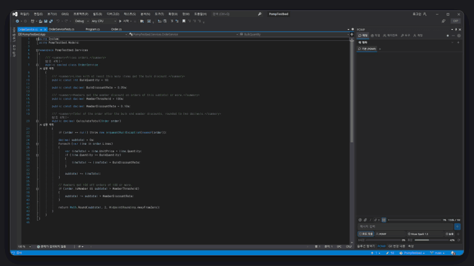

**Ask POMP in place** — Ask about the selected lines where they are and send it to the chat.

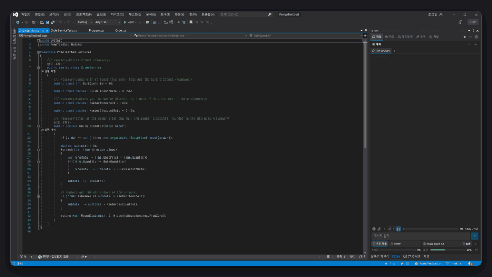

**Approve a fix, then the Work tab** — Read the diff on the request card; allowed, it goes into the editor buffer and the Work tab keeps the record.

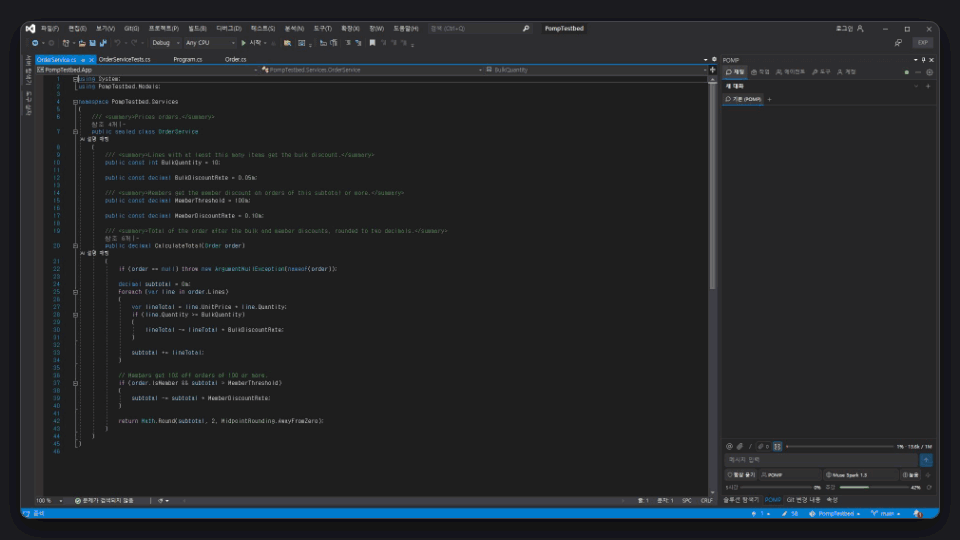

**Live marks and POMP bookmarks** — With Live and bookmarks on, the editor follows the edit and marks the changed line with `+`; click it for the before/after comparison. The Bookmarks window gets a folder per conversation.

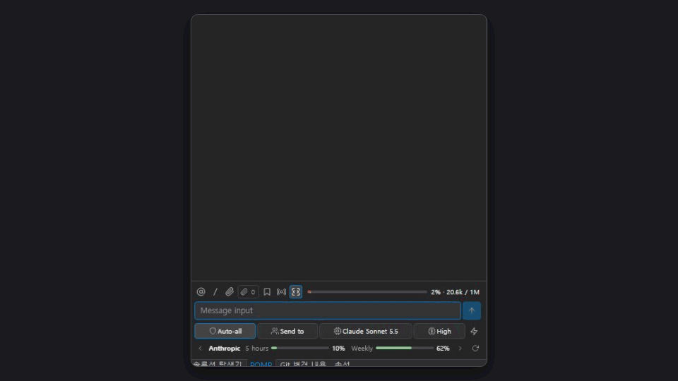

**Selected lines as knowledge** — Keep selected lines as named knowledge to send along with chats and agents.

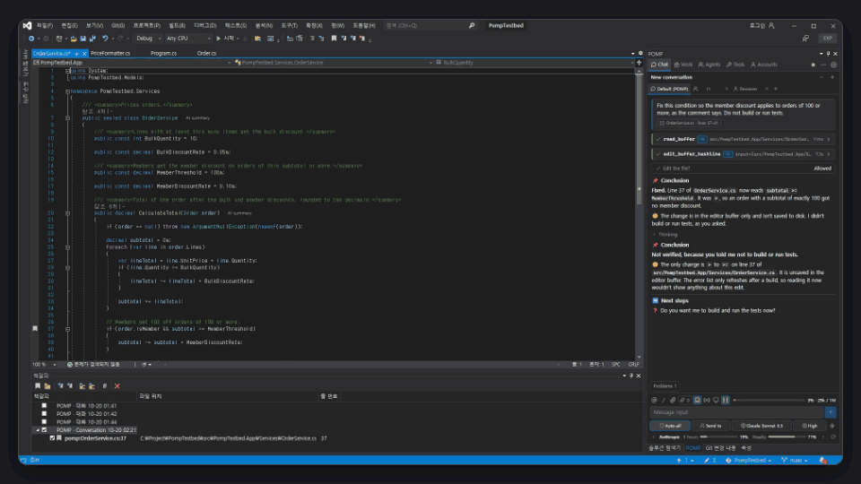

**Context basket** — Put files into the basket and ask about just those.

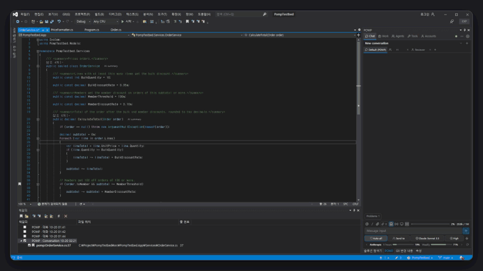

<table>
  <tr>
    <td align="center" valign="top" width="50%"><b>Slash commands, @ mentions, permission mode, send target</b> Pick commands and files in the input; choose the permission mode and who receives the message.  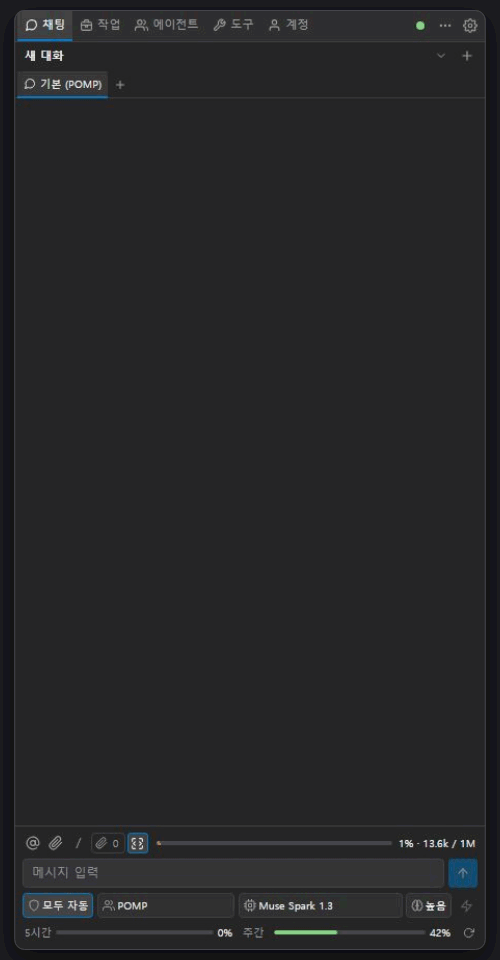</td>
    <td align="center" valign="top" width="50%"><b>Delegating to an agent</b> Open a role agent as a partner tab and hand it work.  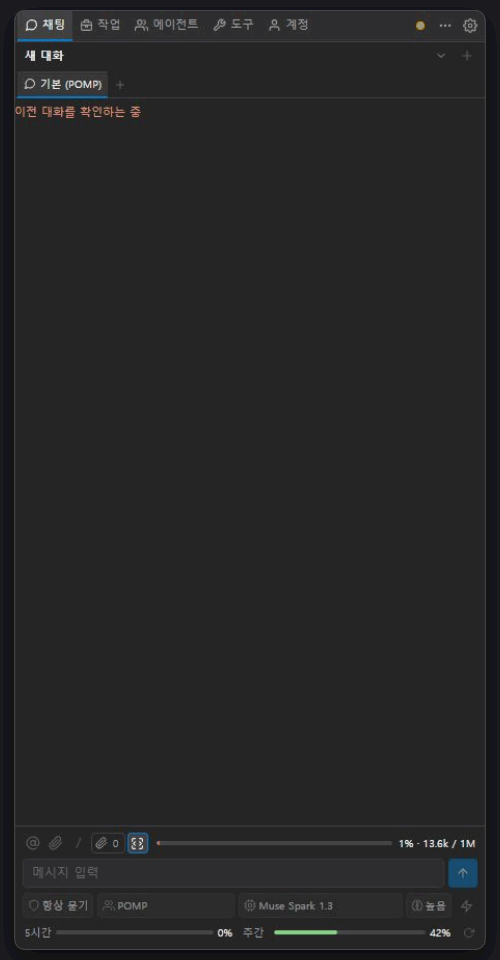</td>
  </tr>
  <tr>
    <td align="center" valign="top" width="50%"><b>Advisors</b> &nbsp; An advisor watches the main agent and comments on its work.  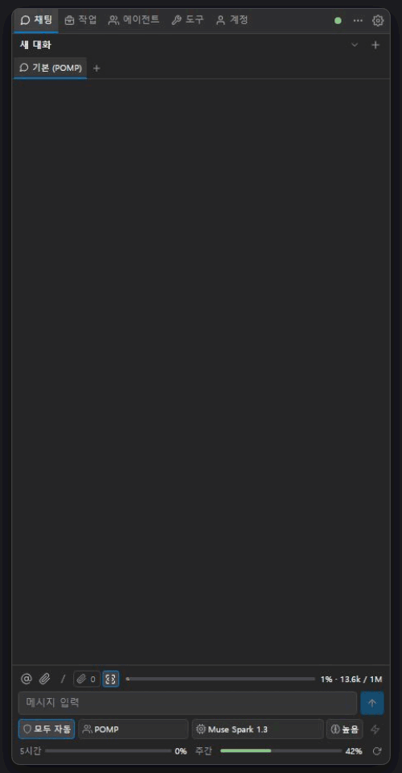</td>
    <td align="center" valign="top" width="50%"><b>Role pictures and POMP's instructions</b> Give each role a picture and edit POMP's own instructions.  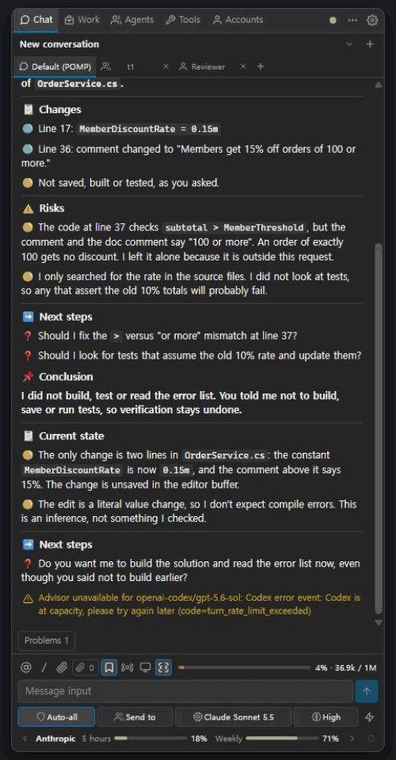</td>
  </tr>
  <tr>
    <td align="center" valign="top" width="50%"><b>Creating a team</b> Group roles into a team.  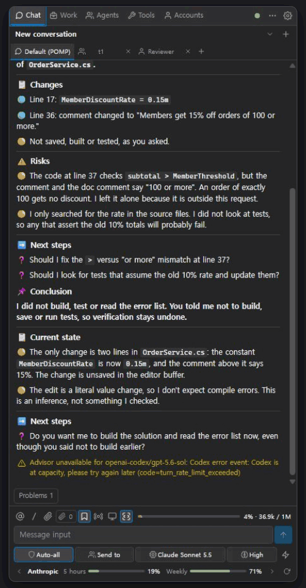</td>
    <td align="center" valign="top" width="50%"><b>Automation rules</b> Attach a notice, a chat message or a script to events such as a failed build.  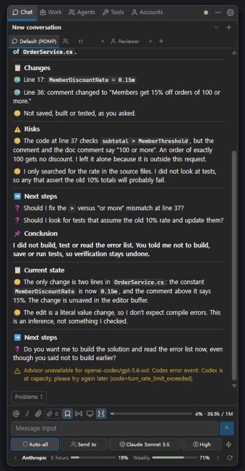</td>
  </tr>
  <tr>
    <td align="center" valign="top" width="50%"><b>Tools tab</b> &nbsp; Conversation tools, permissions, skills, MCP, rules, workflows and knowledge in one place.  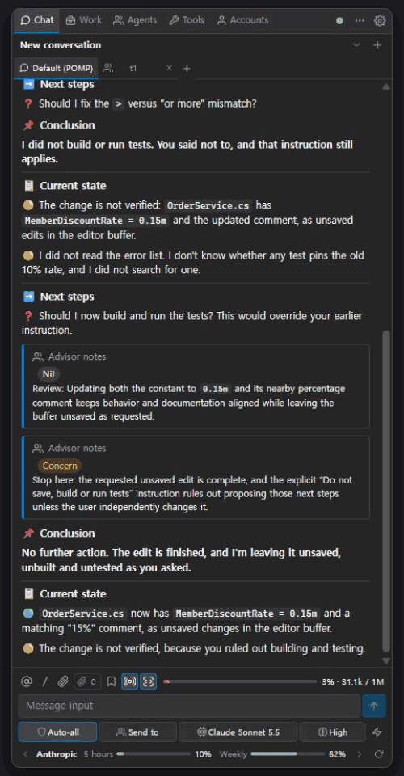</td>
    <td align="center" valign="top" width="50%"><b>Accounts, models and thinking level</b> Connect accounts, then pick the model and the thinking level under the input.  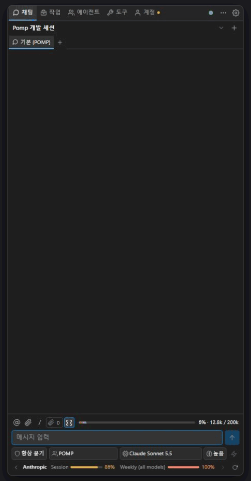</td>
  </tr>
</table>
<!-- /howto-videos -->

## POMP and omp

- **omp** is the engine: model calls, the tool-call loop, subagents, skills and MCP, conversation history. It ships inside the VSIX; nothing else to install.
- **POMP** connects omp to Visual Studio: the editor, solution, builds, tests, debugger, Git and NuGet become the agent's tools, and every change or run waits for an approval card.
- Each POMP release pins one omp version (table above). Details: [Architecture](docs/architecture.md) (Korean).

## Features

| Feature | What it does |
|---|---|
| Right from the editor | Explain, review, fix or write tests for the selected code from the right-click **POMP** menu or a shortcut; **Ask POMP** asks in place. |
| Only what you approve | Changes are shown as a diff; only what you allow goes into the editor buffer. Saving stays with you. |
| Live marks | The editor follows the agent's edits and marks changed lines with `+`/`−`; click one for a before/after comparison and **Revert**. |
| POMP bookmarks | Each request leaves the first changed line of each file in a per-conversation folder of the Bookmarks window. |
| Context basket · knowledge | Put files, folders and symbols in the basket as the scope of a question; keep selected lines as knowledge to send along. |
| Agents · teams · advisors | Hand work to role agents and teams; advisors watch the work and comment. |
| Work and Tools tabs | Plan, change history and code check; permissions, skills, MCP, rules, workflows and knowledge. |
| Accounts · models | Subscription sign-in, API keys or your own model server; pick a model per chat and agent and see usage. |
| draw.io diagrams | Draw diagrams from the code, and apply edits made in the diagram back to the code. |
| `.pomp` folder | Project agents, rules, skills and policies travel with the repository; conversations stay in `.pomp\local\` (not committed). |

### New in 0.5.6

- Engine updated to omp 18.12.1.
- Live: choose where `+`/`−` marks go (after the line or in a left column) and how the comparison is laid out (stacked or side by side); `Esc` closes it.
- Short notices show in the Visual Studio status bar instead of the page.
- What the model says between tool calls (Claude Opus 5.5 and others) shows as answer text.
- A message sent from an agent tab stays in that tab after Visual Studio restarts.
- Live marks work in Visual Studio 2017, and shortcuts register correctly in non-English Visual Studio.

## Screenshots

<table>
  <tr>
    <td align="center">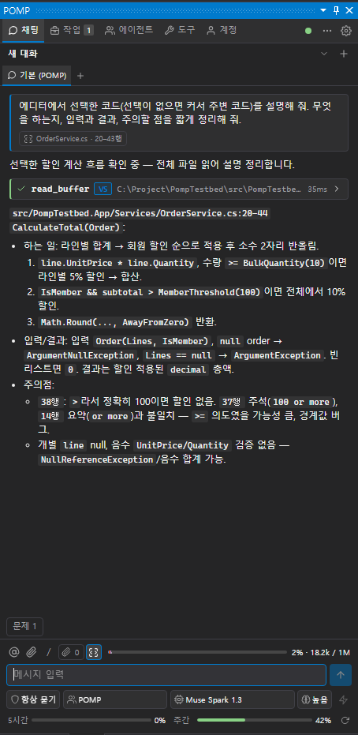 Explaining selected code</td>
    <td align="center">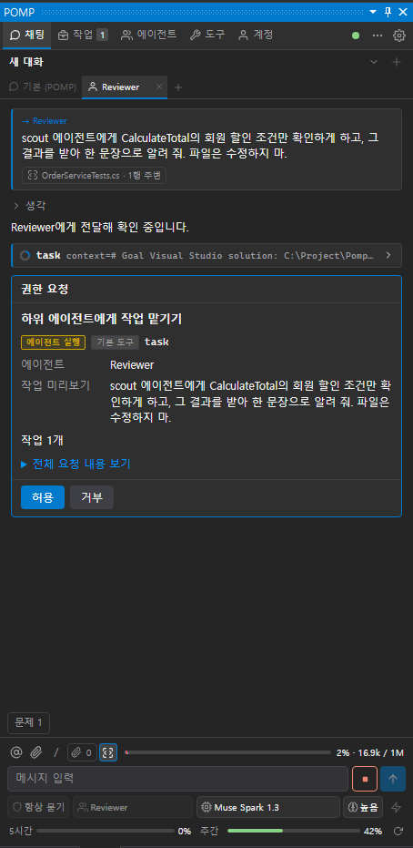 Approval before running</td>
    <td align="center">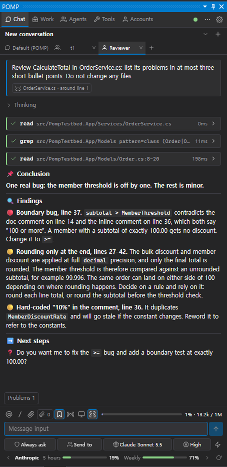 Delegating to an agent</td>
  </tr>
</table>

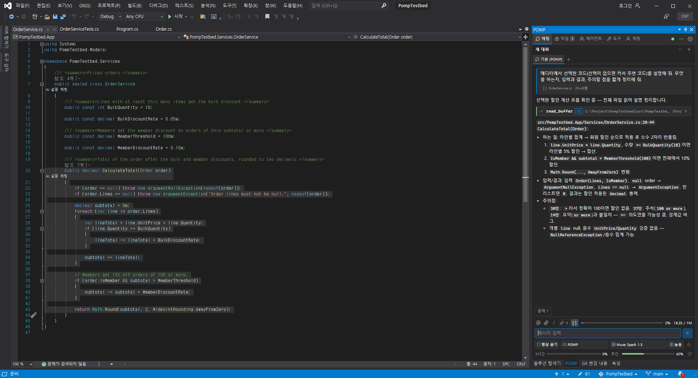

## Install

Requirements
- Windows 10/11 with Visual Studio 2017 15.9, 2019 16.10+, 2022 or 2026 (Community, Professional or Enterprise)
- Microsoft Edge WebView2 Runtime 111 or later (already present on Windows 11 and with current Visual Studio)
- An AI model provider account (subscription sign-in) or an API key

2017 and 2019 are 32-bit programs, 2022 and 2026 are 64-bit. One 64-bit package covers both 2022 and 2026:

| Package | Name in Manage Extensions | Installs into |
|---|---|---|
| `Pomp.VS2017-<version>.vsix` | POMP (VS2017) | Visual Studio 2017 15.9 (no native CodeLens captions) |
| `Pomp.VS2019-<version>.vsix` | POMP (VS2019) | Visual Studio 2019 16.10 – 16.11 |
| `Pomp.VS2022-<version>.vsix` | POMP (VS2022) | Visual Studio 2022 (17.x) · 2026 (18.x) |

Steps
1. **Visual Studio Marketplace** (listing in preparation): in Visual Studio, open **Extensions > Manage Extensions** and search
   for `POMP`.
2. **VSIX file**: pick the package for your version (table above), close all Visual Studio windows and double-click it. To build
   the packages yourself, run `powershell -NoProfile -File build\build.ps1` (output in `artifacts\`); see the
   [development guide](docs/development.md) (Korean) for prerequisites.
3. Reopen Visual Studio and open **View > Other Windows > POMP** (or `Shift+Alt+Q`).

## Quick start

1. **Connect a provider.** The Accounts tab opens the first time. Sign in with a subscription (pick a provider tile under **Add an account** —
   OpenAI, Anthropic, Muse Code and Google Antigravity come first, search for the rest; a browser opens), enter an API key, which is stored
   encrypted for your Windows user, or add a local model server. Once a provider is connected, the dot at the top right turns green.
2. **Ask about code.** Select a method and press `Shift+Alt+E` (or right-click > **POMP > Explain This Code**). The answer appears
   in the Chat tab; the chip under your prompt shows the file and lines that were sent.
3. **Chat.** `Enter` sends, `Shift+Enter` adds a line, `@` mentions files/folders/symbols, `/` lists commands
   (`/new`, `/sessions`, `/model`, `/effort`, `/permissions`, `/compact`, `/help`). The chips under the input box choose the model, thinking
   level (brain icon), fast mode (lightning) and the permission mode. Messages sent while the agent is answering are queued. Optional
   composer predictions appear after typing pauses; Tab accepts and Esc dismisses.
4. **Approve changes.** When the agent wants to change a file or run something, an approval card shows the diff: **Allow**,
   **Deny**, **Always allow** or **Allow for this session** (the last two apply to every request of that tool, and the card
   says so). Applied edits undo with one `Ctrl+Z` per file; POMP never saves for you.
5. **Hand work to an agent.** Click `+` in the partner tab row of the chat and pick a role (for example **reviewer**). Messages in
   that tab start the agent as a subagent after an approval card; once allowed it runs to the end without asking per tool,
   including any agents it delegates to. Follow member status and individual stop controls on the task card in the chat or
   partner tab. Create roles and teams in **Agents > Roles / Teams**; advisors live in **Advisors**, event rules and project hooks in **Automation**.

## Shortcuts

| Keys | Action |
|---|---|
| `Shift+Alt+Q` | Open POMP |
| `Shift+Alt+N` | New conversation |
| `Shift+Alt+E` / `R` / `F` / `U` | Explain / review / fix / write tests for this code |
| `Shift+Alt+I` | Add the current file to the context basket |
| `Alt+M` | Ask POMP |
| `Alt+/` | Add the selected lines to a knowledge |
| `Alt+J` | Switch focus between editor and chat |
| `Alt+;` / `Alt+'` | Open the context basket / toggle editor context |
| `Alt+L` / `Alt+K` | Toggle Live edit following / POMP change bookmarks |
| `Ctrl+Alt+T`, `Alt+,` / `Alt+.` | Send-target (agent or team) list / previous and next target |
| `Alt+Q` | Choose the permission mode |
| `Alt+A` / `Alt+D` | Allow / deny the approval card |

Every key, including the chat window's, is set in Tools > Options > Pomp > General > Shortcuts.

## Documentation

The detailed docs are in Korean.

| Document | Contents |
|---|---|
| [Overview](docs/overview.md) | What POMP is, how it works, what it can do, safety model |
| [Quick start](docs/quick-start.md) | From install to the first question, change and delegation |
| [Screen guide](docs/screen-guide.md) | Every tab and button, with real screenshots |
| [Agents and teams](docs/agent-teams.md) | Roles, teams, partners, member stop and automation |
| [Development](docs/development.md) | Build, debugging, layout, implemented scope |
| [Architecture](docs/architecture.md) · [UI protocol](docs/ui-protocol.md) | Implementation reference and internal message formats |
| [Marketplace overview](build/marketplace/overview.md) | English feature and safety summary |

## Safety

- The default approval mode asks every time (`Always ask`). File and project changes, builds, tests, shell commands, Git, NuGet
  and debugger actions run only after approval. "Allow for this session" and "Always allow" stop asking for that tool.
- Allowing a subagent (`task`) lets it run to the end without asking per tool; the approval card says so.
- POMP is not an OS sandbox. Review an untrusted repository's tool rules, MCP settings and other executable configuration
  in the workspace trust card before starting.
- The network tools (web search, URL reads, GitHub, browser) are allowed by default and logged; the option
  *Block network tools* turns them off.
- Usage statistics stay in `%LOCALAPPDATA%\Pomp\usage-metrics.json` on this PC and are never sent anywhere.

## License

**POMP** (this repository's code, documents and UI) is source-available software made and distributed by
**`momopanda123`** under the **PolyForm Noncommercial License 1.0.0**: free for personal and noncommercial use, no
commercial use. See [`LICENSE.txt`](LICENSE.txt). Marketplace publisher ID: **`momopanda123`**.

POMP's conversation and agent engine **omp** is the official release binary of
[oh-my-pi](https://github.com/can1357/oh-my-pi) (**MIT licensed**), and POMP's PolyForm license does not
apply to it. The VSIX's `omp/THIRD-PARTY-NOTICES.txt` carries the licenses of omp itself and its bundled open-source
components (MIT and others). Other bundled open-source components keep their own licenses as well (see the bundled
components' `LICENSE.txt` and `THIRD-PARTY-NOTICES.txt` in the package).

Other companies' product and service names in these documents and in the product are trademarks of their owners. POMP is not
affiliated with them and uses the names only to refer to what it works with.
