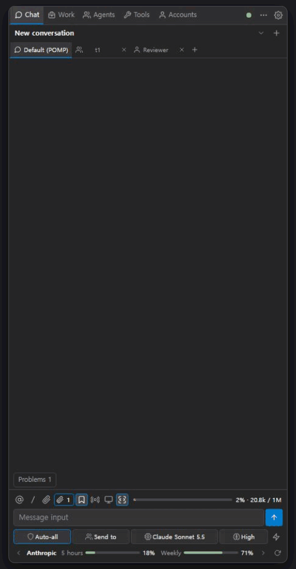

# POMP

**한국어** | [English](README.en.md)

**Visual Studio 안의 AI 코딩 파트너.** 편집기 옆 창에서 AI 에이전트에게 코드 읽기·수정·빌드·테스트·디버깅을 맡긴다.
Visual Studio 2017(15.9) · 2019(16.10+) · 2022 · 2026을 지원하고, 화면은 한국어와 영어로 나온다.

| 구성 요소 | 버전 | 맡는 일 |
|---|---|---|
| POMP | 0.5.7 | Visual Studio 확장: 채팅 화면, VS 도구, 승인 카드, 에이전트·팀 관리 |
| omp | 18.12.1 | 함께 들어 있는 대화·에이전트 엔진 [oh-my-pi](https://github.com/can1357/oh-my-pi)(MIT) |

<!-- howto-videos -->
## 기능별 영상

영상은 POMP 언어를 영어로 둔 화면이다. 한국어로 두면 POMP 메뉴와 화면이 한국어로 나온다.

**편집기에서 코드 설명** — 코드를 선택하고 우클릭 › POMP › 이 코드 설명. 설명은 채팅에 나온다.

**POMP에게 질문** — 선택한 줄에 대해 그 자리에서 묻고, 채팅으로 보낸다.

**수정 제안 승인과 작업 탭** — 고칠 내용을 Diff로 보고 허용하면 편집기 버퍼에 들어간다. 적용 기록은 작업 탭에 남는다.

**Live 표시와 POMP 책갈피** — Live와 책갈피를 켜면 편집기가 고친 곳으로 따라가고 바뀐 줄에 `+` 표시가 붙는다. `+`를 누르면 이전·이후 비교, 책갈피 창에는 대화별 폴더가 생긴다.

**선택한 줄을 지식으로** — 선택한 줄을 지식에 담아 이름을 붙인다. 대화와 에이전트에 함께 보낼 수 있다.

**컨텍스트 바구니** — 파일을 바구니에 담고, 담긴 파일 범위로 질문한다.

<table>
  <tr>
    <td align="center" valign="top" width="50%"><b>슬래시 명령 · @ 멘션 · 권한 모드 · 보낼 대상</b> 입력창에서 명령과 파일을 고르고, 권한 모드와 보낼 대상을 정한다.  </td>
    <td align="center" valign="top" width="50%"><b>작업 중 지시 · BTW</b> &nbsp; 작업이 도는 동안 대기열의 메시지를 지금 보내기로 바로 전하고, /btw로 작업과 별도로 잠깐 묻는다.  </td>
  </tr>
  <tr>
    <td align="center" valign="top" width="50%"><b>에이전트에게 위임</b> 역할 에이전트를 대화 상대 탭으로 열고 일을 맡긴다.  </td>
    <td align="center" valign="top" width="50%"><b>조언자</b> 조언자를 켜면 주 에이전트의 작업을 지켜보고 의견을 낸다.  </td>
  </tr>
  <tr>
    <td align="center" valign="top" width="50%"><b>역할 그림과 POMP 지시</b> 역할마다 그림을 정하고, POMP 자신의 지시를 편집한다.  </td>
    <td align="center" valign="top" width="50%"><b>팀 만들기</b> 여러 역할을 묶어 팀을 만든다.  </td>
  </tr>
  <tr>
    <td align="center" valign="top" width="50%"><b>자동화 규칙</b> 빌드 실패 같은 이벤트에 알림·채팅 전달·스크립트를 건다.  </td>
    <td align="center" valign="top" width="50%"><b>도구 탭</b> 대화 설정·권한·스킬·MCP·규칙·워크플로·지식을 한곳에서 관리한다.  </td>
  </tr>
  <tr>
    <td align="center" valign="top" width="50%"><b>계정 · 모델 · 추론 수준</b> 계정을 연결하고, 입력창 아래에서 모델과 추론 수준을 고른다.  </td>
  </tr>
</table>
<!-- /howto-videos -->

## POMP와 omp

- **omp**는 모델 호출, 도구 호출 반복, 하위 에이전트, 스킬·MCP, 대화 기록을 맡는 엔진이다. VSIX에 들어 있어 따로 설치하지 않는다.
- **POMP**는 omp를 Visual Studio에 연결한다. 편집기·솔루션·빌드·테스트·디버거·Git·NuGet을 에이전트 도구로 주고, 변경과 실행은 승인 카드로 묻는다.
- POMP 릴리스마다 omp 버전 하나를 고정해 함께 배포한다(위 표). 자세한 구조는 [아키텍처](docs/architecture.md).

## 주요 기능

| 기능 | 설명 |
|---|---|
| 편집기에서 바로 | 선택한 코드를 우클릭 **POMP** 메뉴나 단축키로 설명·리뷰·수정·테스트 작성. **POMP에게 질문**으로 그 자리에서 묻는다. |
| 승인한 것만 적용 | 변경은 Diff로 보여 주고, 허용한 것만 편집기 버퍼에 넣는다. 저장은 사용자가 한다. |
| Live 표시 | 에이전트가 고친 위치로 편집기가 따라가고, 바뀐 줄에 `+`/`−` 표시가 붙는다. 언어와 관계없다. 누르면 이전·이후 비교와 **원복**. |
| POMP 책갈피 | 요청마다 바뀐 파일의 첫 줄을 VS 책갈피 창의 대화별 폴더에 남긴다. |
| 컨텍스트 바구니 · 지식 | 파일·폴더·심볼을 담아 질문 범위로 쓰고, 선택한 줄은 지식으로 저장해 함께 보낸다. |
| 작업 중 지시 · BTW | 작업 중에 대기열 메시지의 **지금 보내기**(또는 `/steer`)로 하던 작업에 바로 전하고, `/btw`로 작업과 별도로 잠깐 묻는다. |
| 에이전트 · 팀 · 조언자 | 역할 에이전트와 팀에게 일을 맡기고, 조언자가 작업을 지켜보며 의견을 낸다. |
| 작업 탭 · 도구 탭 | 계획·변경 기록·코드 점검, 그리고 권한·스킬·MCP·규칙·워크플로·지식 관리. |
| 계정 · 모델 | 구독 로그인, API 키, 직접 띄운 모델 서버. 채팅·에이전트마다 모델을 고르고 사용량을 본다. |
| draw.io 다이어그램 | 코드에서 다이어그램을 그리고, 다이어그램에서 고친 내용을 코드에 반영한다. |
| `.pomp` 폴더 | 프로젝트용 에이전트·규칙·스킬·정책은 저장소와 함께, 대화 기록은 `.pomp\local\`(커밋 제외)에 둔다. |

## 화면

<table>
  <tr>
    <td align="center"> 선택한 코드 설명</td>
    <td align="center"> 실행 전 승인</td>
    <td align="center"> 에이전트에게 위임</td>
  </tr>
</table>

화면별 설명은 [화면 가이드](docs/screen-guide.md)에 있다.

## 설치

필요한 것
- Windows 10/11, Visual Studio 2017 15.9, 2019 16.10 이상, 2022, 2026 (Community · Professional · Enterprise)
- Microsoft Edge WebView2 Runtime 111 이상 (Windows 11과 최신 VS에는 이미 들어 있다)
- AI 모델 공급자 계정(구독 로그인) 또는 API 키

VS 2017·2019는 32비트, 2022·2026은 64비트 프로그램이어서 패키지를 나눠 배포한다. 64비트 패키지 하나가 2022와 2026을 함께 커버한다.

| 패키지 | 확장 관리에 보이는 이름 | 설치되는 VS |
|---|---|---|
| `Pomp.VS2017-<버전>.vsix` | POMP (VS2017) | Visual Studio 2017 15.9 (기본 CodeLens 캡션 없음) |
| `Pomp.VS2019-<버전>.vsix` | POMP (VS2019) | Visual Studio 2019 16.10 – 16.11 |
| `Pomp.VS2022-<버전>.vsix` | POMP (VS2022) | Visual Studio 2022 (17.x) · 2026 (18.x) |

설치
1. **Visual Studio Marketplace** (등록 준비 중): VS의 **확장 > 확장 관리**에서 `POMP`를 검색해 설치한다.
2. **VSIX 파일**: VS 버전에 맞는 VSIX를 고르고(위 표), Visual Studio를 모두 닫은 뒤 더블클릭해 설치한다.
   직접 빌드하려면 [개발 문서](docs/development.md#빌드)를 따른다(`build\build.ps1` → `artifacts\`).
3. VS를 다시 열고 **보기 > 다른 창 > POMP**(또는 `Shift+Alt+Q`)로 연다. 처음에는 계정 탭이 열린다 — 로그인하거나 API 키를 넣으면
   바로 시작한다.

처음 쓰는 순서는 [빠른 시작](docs/quick-start.md)에 단계별로 정리했다.

## 단축키

| 키 | 동작 |
|---|---|
| `Shift+Alt+Q` | POMP 열기 |
| `Shift+Alt+N` | 새 대화 |
| `Shift+Alt+E` / `R` / `F` / `U` | 이 코드 설명 / 리뷰 / 고치기 / 테스트 작성 |
| `Shift+Alt+I` | 현재 파일을 컨텍스트 바구니에 추가 |
| `Alt+M` | POMP에게 질문 |
| `Alt+/` | 선택한 줄을 지식에 추가 |
| `Alt+J` | 편집기 ↔ 채팅 포커스 전환 |
| `Alt+;` / `Alt+'` | 컨텍스트 바구니 열기 / 편집기 컨텍스트 포함 켜고 끄기 |
| `Alt+L` / `Alt+K` | Live 수정 따라가기 / POMP 변경 책갈피 켜고 끄기 |
| `Ctrl+Alt+T`, `Alt+,` / `Alt+.` | 보낼 대상(에이전트·팀) 목록 / 이전·다음 대상 |
| `Alt+Q` | 권한 모드 고르기 |
| `Alt+A` / `Alt+D` | 승인 카드 허용 / 거부 |

모든 키는 도구 › 옵션 › Pomp › 일반 › 단축키에서 바꾼다(채팅 창 안의 키도 같은 곳). 채팅 입력창에서는 `Enter` 전송, `Shift+Enter` 줄바꿈, `@` 파일 멘션, `/` 명령.

## 문서

| 문서 | 내용 |
|---|---|
| [개요](docs/overview.md) | POMP가 무엇이고 어떻게 동작하는지, 할 수 있는 일, 안전 모델 |
| [빠른 시작](docs/quick-start.md) | 설치부터 첫 질문·첫 변경·에이전트 위임까지 |
| [화면 가이드](docs/screen-guide.md) | 실제 화면으로 보는 탭·버튼 설명 |
| [설정 안내](docs/settings.md) | 도구 > 옵션 > Pomp의 각 설정이 하는 일·기본값·재시작 여부 |
| [에이전트·팀](docs/agent-teams.md) | 에이전트·팀 만들기와 쓰기, 구성원 중지, 자동화 |
| [개발 문서](docs/development.md) | 빌드, 디버깅, 구성, 구현 범위 |
| [아키텍처](docs/architecture.md) · [UI 프로토콜](docs/ui-protocol.md) | 구현 기준과 내부 메시지 규약 |

## 안전에 관해

- 기본 승인 모드는 매번 묻기(`Always ask`)다. 파일·프로젝트 변경, 빌드·테스트·셸 실행, Git·NuGet·디버거 조작은 승인 뒤에만 한다.
  "이 세션 동안 허용"·"항상 허용"을 고르면 그 도구는 다시 묻지 않는다.
- 하위 에이전트 실행(`task`)을 허용하면 그 에이전트는 작업이 끝날 때까지 도구별로 다시 묻지 않는다 — 승인 카드가 이를 알려 준다.
- POMP는 OS 샌드박스가 아니다. 신뢰할 수 없는 저장소의 도구 규칙·MCP 설정 같은 실행 설정은 시작 전 신뢰 카드에서 검토한다.
- 네트워크 도구(웹 검색·URL 읽기·GitHub·브라우저)는 기본으로 허용되고 모두 기록된다. 옵션 **네트워크 도구 차단**으로 끈다.
- 사용 통계는 이 PC의 `%LOCALAPPDATA%\Pomp\usage-metrics.json`에만 남고 어디로도 보내지 않는다.

자세한 내용은 [개요의 안전 모델](docs/overview.md#안전-모델)과 [개발 문서의 보안 주의](docs/development.md#보안-주의).

## 라이선스

**POMP**(이 저장소의 코드·문서·화면)는 **momopanda123**이 만들고 배포하는 소스 공개(source-available) 소프트웨어로,
**PolyForm Noncommercial License 1.0.0**을 따른다. 개인·비상업적 사용은 무료이며 상업적 사용은 허용하지 않는다.
전체 조건은 [`LICENSE.txt`](LICENSE.txt). Marketplace Publisher ID는 **momopanda123**이다.

POMP의 대화·에이전트 엔진 **omp**는 [oh-my-pi](https://github.com/can1357/oh-my-pi)(**MIT 라이선스**)의 공식 릴리스 바이너리로,
POMP의 PolyForm 라이선스가 적용되지 않는다. VSIX 안의
`omp/THIRD-PARTY-NOTICES.txt`에 omp 자체와 포함된 오픈 소스 구성 요소의 라이선스(MIT 등)가 들어 있다.
그 밖의 포함된 오픈 소스 구성 요소도 각자의 라이선스를 유지한다(포함된 구성 요소의 `LICENSE.txt`·`THIRD-PARTY-NOTICES.txt` 참조).

이 문서와 화면에 나오는 다른 회사의 제품·서비스 이름은 각 소유자의 상표다. POMP는 그 회사들과 관계가 없고, 그 이름은 연동·호환 대상을
가리키는 데만 쓴다.
