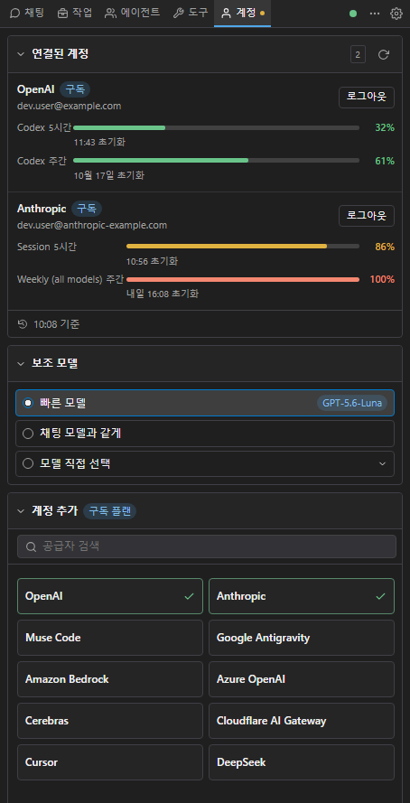
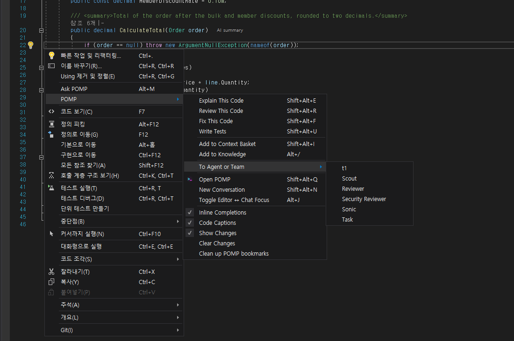

# POMP 빠른 시작

설치부터 첫 질문, 첫 코드 변경, 에이전트 위임까지 10분 안에 따라 할 수 있는 순서다.
화면 각 부분의 설명은 [화면 가이드](screen-guide.md)에 있다.

## 1. 설치

1. VS 버전에 맞는 VSIX를 준비한다.
   - VS 2017 15.9: `Pomp.VS2017-<버전>.vsix`
   - VS 2019 16.10 이상: `Pomp.VS2019-<버전>.vsix`
   - VS 2022·2026: `Pomp.VS2022-<버전>.vsix`
   - 직접 빌드: `powershell -NoProfile -File build\build.ps1` → `artifacts\` ([개발 문서](development.md#빌드))
2. Visual Studio를 모두 닫고 VSIX를 더블클릭한다.
3. VSIX Installer가 끝나면 VS를 다시 연다.

따로 설치할 것은 없고 터미널도 필요 없다.
채팅 화면에는 WebView2 Runtime이 필요하다. 없으면 POMP 창에 설치 안내가 나온다.

## 2. POMP 열기

다음 중 하나로 연다.

- **보기 > 다른 창 > POMP**
- `Shift+Alt+Q`

단축키는 도구 › 옵션 › Pomp › 일반 › 단축키에서 바꿀 수 있다.
POMP 창은 다른 도구 창처럼 원하는 곳에 끌어 붙인다. 편집기 오른쪽에 세로로 길게 두면 쓰기 편하다.

## 3. 모델 공급자 연결

처음 열면 **계정** 탭이 열린다. 아래 방법 중 하나로 연결한다.

### 구독 계정으로 로그인

1. **계정 추가**에서 공급자 타일을 누른다.
2. 브라우저가 열리면 로그인한다. 끝나면 POMP로 돌아온다.
3. 코드를 붙여 넣으라는 공급자라면 화면의 입력란에 붙여 넣는다.

OpenAI, Anthropic, Muse Code, Google Antigravity 타일이 먼저 보인다. 나머지는 검색으로 찾는다.

### API 키로 연결

1. **+ 키 추가**를 누른다.
2. 공급자를 고르고 키를 넣는다.

키는 이 PC에 암호화해 저장한다.

### 직접 띄운 모델 서버

1. **+ 키 추가**의 공급자에서 **로컬 모델 서버**를 고른다.
2. 이름과 서버 주소를 넣는다. 주소는 OpenAI 호환 주소다. 예: `http://127.0.0.1:8000/v1`
3. 키가 필요 없는 서버면 API 키는 비워 둔다.
4. 저장한 뒤 오른쪽 위 `⋯` › **다시 시작**을 누른다.

다시 시작하면 그 서버의 모델이 입력한 이름으로 모델 목록에 나온다.

### 연결 확인

연결되면 오른쪽 위 연결 점이 초록색이 된다.
여러 공급자를 연결해 두면 채팅과 에이전트마다 다른 모델을 쓸 수 있다.

## 4. 편집기에서 첫 질문

1. 솔루션을 열고 코드 파일에서 메서드 하나를 선택한다.
2. 우클릭 → **POMP > 이 코드 설명**을 누른다. `Shift+Alt+E`도 된다.

POMP 창의 채팅 탭에 질문과 답이 나온다.
질문 아래 칩은 함께 보낸 편집기 위치다. 예: `OrderService.cs · 20–43행`

같은 메뉴에 다른 명령도 있다.

| 메뉴 | 단축키 |
|---|---|
| **이 코드 리뷰** | `Shift+Alt+R` |
| **이 코드 고치기** | `Shift+Alt+F` |
| **테스트 작성** | `Shift+Alt+U` |
| **POMP에게 질문** | `Alt+M` |

메뉴 맨 위의 **POMP에게 질문**은 선택 영역에 대한 질문이나 바꿀 지시를 바로 입력하는 명령이다.

## 5. 채팅으로 묻기

입력창에 쓰고 `Enter`로 보낸다. 줄바꿈은 `Shift+Enter`다.
도구 > 옵션 > Pomp > 일반 > 단축키에서 `Ctrl+Enter` 전송으로 바꿀 수 있다.

### 컨텍스트 붙이기

- 입력창 위의 `@`로 파일, 폴더, 심볼을 멘션한다.
- 클립 아이콘으로 파일을 첨부한다. 개수 제한은 없다.

### 명령

`/`를 치면 명령 목록이 나온다.

| 명령 | 동작 |
|---|---|
| `/new` | 새 대화 |
| `/sessions` | 대화 목록 |
| `/model` | 모델 |
| `/compact` | 대화 압축 |
| `/help` | 전체 목록 |

### 입력창 아래 선택

입력창 아래에서 다음을 바꾼다.

- 권한 모드: `항상 묻기` · `쓰기 자동` · `모두 자동`
- 보낼 대상
- 모델
- 추론 단계: 뇌 아이콘
- fast 모드: 번개 아이콘

### 그 밖

- 응답 중에 보낸 메시지는 대기열에 들어간다. 응답이 끝나면 차례로 실행된다.
- `■`은 지금 응답을 멈춘다.
- 상단 대화 목록에서 대화를 삭제할 수 있다. 한 번 더 확인하고, 현재 대화라면 새 대화를 먼저 시작한다.
- 옵션 **입력 예측 문장**을 켜면 입력을 잠시 멈췄을 때 이어질 문장을 보여 준다. `Tab`으로 받고, `Esc`나 다른 입력으로 지운다.

## 6. 코드 고치기와 승인

1. "이 메서드의 null 처리를 고쳐 줘"처럼 변경을 요청한다.
2. 에이전트가 파일을 바꾸기 전에 대화 맨 아래에 **승인 카드**가 나온다.
3. 카드의 Diff로 바꿀 내용을 확인한다.
4. **허용**하면 그 내용 그대로 편집기 버퍼에 들어간다.
5. 결과를 확인하고 직접 저장한다. POMP는 자동 저장하지 않는다.

### 승인 카드에서 고르기

| 선택 | 결과 |
|---|---|
| **허용** | 카드의 내용 그대로 적용한다. |
| **거부** | 아무것도 바뀌지 않는다. |
| **이 세션 동안 허용** | 이 세션에서 그 도구의 요청을 다시 묻지 않는다. |
| **항상 허용** | 그 도구의 요청을 다시 묻지 않는다. |

카드에는 허용의 적용 범위가 적혀 있다.
편집, 빌드 같은 VS 도구의 카드에는 이유 입력란이 있다. 거부할 때 적은 이유가 에이전트에게 전달된다.

### 키보드로 답하기

| 키 | 동작 |
|---|---|
| `Enter` / `Esc` | 카드에 포커스가 있을 때 허용 / 거부 |
| `Alt+A` / `Alt+D` | 어디서나 허용 / 거부 |

### 되돌리기와 여러 파일

- 적용된 변경은 파일마다 `Ctrl+Z` 한 번으로 되돌린다.
- 여러 파일에 걸친 제안은 **작업 탭 › 변경 › 대기 중**에서 줄 단위로 골라 적용할 수 있다.

빌드, 테스트 실행, 셸 명령, Git 커밋·푸시, NuGet 변경, 디버거 조작도 같은 방식으로 먼저 묻는다.

## 7. 에이전트에게 맡기기

1. 채팅 상단 대화 상대 탭 줄의 `+`를 누른다.
2. 역할을 고른다. 예: **검토**
3. 그 에이전트와만 대화하는 탭이 열린다. 이 탭에 메시지를 보낸다.
4. "하위 에이전트에게 작업 맡기기" 승인 카드가 대화 안에 나온다. 허용한다.

위 그림은 에이전트 `검토`에게 일을 맡기는 승인 카드다.
에이전트 탭에 보낸 메시지는 POMP가 그 에이전트를 하위 에이전트로 실행해 전달한다.

허용하면 그 에이전트는 끝날 때까지 도구별로 다시 묻지 않고 진행한다.
그 에이전트가 다른 에이전트에게 다시 일을 맡기는 것도 여기에 포함된다.

위 그림에서는 검토 에이전트가 scout에게 확인을 맡기고, 결과를 받아 답했다.

편집기에서 바로 보낼 수도 있다. 코드를 선택하고 우클릭 **POMP ▸ 에이전트·팀에게**를 고르면 그 에이전트나 팀에게 간다.

### 진행 보기와 중지

진행 상황은 채팅의 **작업 카드**와 에이전트·팀 대화 상대 탭에서 본다.
구성원별로 상태, 도구 수, 시간, 최근 도구와 **중지** 버튼이 있다.
개별 중지는 같은 줄에서 한 번 더 확인하고 그 구성원만 멈춘다.

### 역할과 팀 만들기

새 역할이나 팀은 **에이전트 탭 › 역할 / 팀**에서 만든다. 역할마다 모델, 추론 단계, 도구 범위를 정할 수 있다.
대화를 지켜보는 조언자는 **조언자**에서, 이벤트 규칙과 프로젝트 훅은 **자동화**에서 관리한다.
자세한 내용은 [에이전트·팀](agent-teams.md)에 있다.

## 8. 진행 확인

### 작업 탭

| 화면 | 내용 |
|---|---|
| **진행** | 계획, 워크플로, 자동 계속 |
| **변경** | **대기 중**인 제안과 격리 결과, **적용됨** 기록과 되돌리기 |
| **코드 점검** | 에이전트의 리뷰 지적, VS 컴파일러 오류와 경고 |

항목을 고르고 **에이전트에게 해결 요청**을 누르면 현재 보낼 대상에게 한 메시지로 보낸다.
한 번에 최대 50개, 12,000자까지 보낸다. 편집기 컨텍스트는 붙지 않는다.
변경 칩의 숫자는 대기 중인 항목만 센다.

### 명령 작업

승인된 명령 작업은 채팅의 해당 도구 카드에 나온다. 카드에서 상태를 보고 **출력**과 **취소**를 쓴다.

### 사용량 막대

- 입력창 위 막대는 컨텍스트 창 사용량이다.
- 맨 아래 막대는 계정의 **5시간 / 주간** 사용량이다. 보고되지 않은 구간은 보이지 않는다.

## 9. 문제가 생기면

| 증상 | 해결 |
|---|---|
| 창에 WebView2 설치 안내가 나온다 | Microsoft Edge WebView2 Runtime을 설치하고 VS를 다시 연다. |
| 연결 점이 빨간색이다 | 점을 누르면 다시 연결한다. 계속되면 `⋯` > 다시 시작을 누른다. |
| 연결 점이 "설정 필요"다 | 계정 탭에서 로그인하거나 API 키를 넣는다. |
| 원인을 알고 싶다 | `⋯` > 로그 보기. 로그 파일은 `%LOCALAPPDATA%\Pomp\logs\pomp-vs.log`다. |
| 화면 언어를 바꾸고 싶다 | 도구 > 옵션 > Pomp > 일반 > 채팅 > 언어 |

## 단축키 요약

| 키 | 동작 |
|---|---|
| `Shift+Alt+Q` | POMP 열기 |
| `Shift+Alt+N` | 새 대화 |
| `Shift+Alt+E` | 이 코드 설명 |
| `Shift+Alt+R` | 이 코드 리뷰 |
| `Shift+Alt+F` | 이 코드 고치기 |
| `Shift+Alt+U` | 테스트 작성 |
| `Shift+Alt+I` | 현재 파일을 컨텍스트 바구니에 추가 |
| `Alt+M` | POMP에게 질문 |
| `Alt+/` | 선택한 줄을 지식에 추가 |
| `Alt+J` | 편집기 ↔ 채팅 포커스 전환 |
