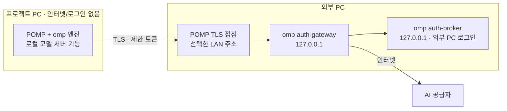

# POMP 원격 모델 사용 계획 (외부 PC 모델 공유)

상태: 0.6.0에 구현했다. 한 PC 안의 VS 두 개로 검증했고, 실제로 다른 두 PC 사이(LAN, 방화벽)는 아직 확인하지 않았다.

이전 계획(외부 PC에서 프로젝트 PC의 작업환경을 원격으로 보고 편집하는 원격 IDE)은 규모가 목적보다 커서 폐기했고,
코드는 0.5.10으로 되돌렸다. 이 문서는 그 자리를 대신한다.

## 1. 목표

**인터넷과 AI 계정이 있는 외부 PC가 자기 모델을 LAN에 서버처럼 열어 두고, 인터넷·로그인·API 키가 없는 프로젝트 PC의
POMP가 그 서버에 연결해 평소처럼 쓴다.** 로컬 LLM 서버를 붙이는 것과 같은 방식이다.

- 프로젝트 PC는 인터넷 연결·공급자 계정 로그인·API 키가 없는 상태를 기준으로 한다.
- 공급자 인증과 인터넷 AI 통신은 외부 PC만 맡는다. 프로젝트 PC는 인증된 LAN 접점만 사용한다.
- VS, 파일, 빌드, 테스트, 디버깅, 채팅, 승인, 에이전트는 모두 프로젝트 PC의 VS와 POMP에서 지금과 똑같이 동작한다.
  원격 탭, 원격 뷰어, 버퍼 동기화는 만들지 않는다.

## 2. 사용 흐름

1. **외부 PC:** 원격 탭 → **다른 PC에 내 모델 공유** → 주소(LAN IPv4)·포트를 고르고 켠다. 주소와 1회용 연결 코드
   `XXXX-XXXX-XXXX-XXXX-XXXX-XXXX`가 나온다(10분, 1회).
2. **프로젝트 PC:** 원격 탭 → **다른 PC 모델 연결** → 주소(`192.168.0.10:47611`)와 연결 코드를 입력하고 연결한다.
   로그인이 없는 첫 실행에서도 원격 탭은 열리고, 계정 탭 첫 화면에 원격 탭 안내가 나온다.
3. 외부 PC 계정의 모델이 모델 선택기에 `외부 PC 이름` 공급자로 나온다(엔진이 돌고 있었다면 원격 탭의 **다시 시작** 뒤). 평소처럼 고르고 쓴다.
4. 외부 PC의 **연결된 PC** 목록에서 언제든 끊을 수 있다(그 PC의 토큰은 10초 안에 거절된다).

## 3. 구조

| 부분 | 결정 |
|---|---|
| 모델 서버 | 번들 omp의 `auth-broker serve`(외부 PC의 omp 로그인)와 `auth-gateway serve --clients`(OpenAI 호환 `/v1/chat/completions`, `/v1/models`)를 POMP가 소유 프로세스로 실행한다. 둘 다 `127.0.0.1`에만 바인딩한다. 0.5.10 번들 엔진에 이미 있는 기능이라 엔진 패치는 없다. |
| LAN 접점 | POMP(C#)가 선택한 LAN 주소에 TLS 리스너를 연다. 자체 서명 인증서(DPAPI 보관)를 쓰고, 등록 요청 외의 모든 요청은 고정된 loopback gateway로만 그대로 전달한다. CONNECT나 다른 목적지 전달은 없다. |
| 연결 코드 | 1회용 비밀 40비트 + 인증서 SHA-256 앞 80비트를 base32 24자로 표시한다. 프로젝트 PC는 인증서 지문이 코드와 같을 때만 비밀을 보낸다. 5회 틀리면 무효, 10분 만료, 1회 사용. |
| 토큰 | 등록에 성공하면 프로젝트 PC 전용 gateway 클라이언트 토큰을 발급한다. 외부 PC에는 그 SHA-256만 남는다. broker 토큰·gateway 자체 토큰·공급자 키·OAuth 토큰은 프로젝트 PC로 가지 않는다. |
| 프로젝트 PC | 기존 "로컬 모델 서버"(`POMP_LOCAL_MODELS`, `extensions/local-models.ts`)로 등록한다. 토큰은 기존 키처럼 DPAPI로 암호화하고, 고정한 인증서는 POMP가 시작하는 omp에만 `NODE_EXTRA_CA_CERTS`로 신뢰시킨다. OS 인증서 저장소와 방화벽은 바꾸지 않는다. |
| 모델 정보 | 서버의 `/v1/models`가 주는 표시 이름·이미지 입력·컨텍스트·출력 한도를 모델 등록에 반영한다. |
| UI | 최상위 탭 막대의 도구와 계정 사이에 **원격 탭**을 둔다. 공유(외부 PC)와 연결(프로젝트 PC)이 이 탭에 있고, 모델이 없는 첫 실행에도 열린다. 메시지는 계정 탭과 같은 `setup/state`·`setup/command`를 쓴다. |

## 4. 제한

- 외부 PC에서 POMP 계정 탭에 저장한 API 키는 공유되지 않는다. broker는 omp에 로그인한 계정만 제공한다.
- 모델 요청은 OpenAI Chat Completions 형식으로 중계된다. 추론 단계 조절, 네이티브 판단(judge) 같은 공급자 고유 기능은 이 경로에서 보장하지 않는다.
- 외부 PC에서 VS와 POMP가 열려 있어야 서버가 유지된다. 첫 실행 때 Windows가 Visual Studio의 네트워크 허용을 물을 수 있다.
- 주소가 바뀌어 인증서를 다시 만들면 연결된 PC는 새 코드로 다시 연결해야 한다.
- 공유 PC의 VS를 닫거나 공유를 끄면 프로젝트 PC의 요청은 연결 거부로 실패한다. 다시 켜면 다시 연결하지 않아도 이어진다. 끊긴 PC의 요청은 `401` 오류로 보인다.

## 5. 검증

- [x] 0.5.10 번들 omp로 외부 PC 계정 4개를 모델 55개로 열고, 로그인·키가 없는 엔진이 로컬 모델 서버 기능만으로 실제 응답을 받았다(평문 loopback, 코드 변경 없이).
- [x] TLS 접점 + 연결 코드 등록 + 인증서 고정: 실제 `ModelShareService`와 번들 omp, 로그인·키 없는 엔진으로 46개 항목 통과(모델 55개, 이미지·한도 반영, 대화, `read` 도구, CONNECT·평문 거부, 로그에 비밀 없음).
- [x] 실제 VS 2026 두 개(같은 PC, 192.168.0.71:47611): 공유 켜기 → 코드 → 연결 → 모델 선택 → 대화·`read` 도구. 연결 측 엔진이 로그인 없이(omp 에이전트 폴더 비움) 실패 상태에서 연결 → 엔진 자동 시작 → 모델을 고르지 않고 대화·도구까지 확인. VS를 다시 열면 공유가 저절로 다시 켜진다.
- [x] 끊기 뒤 요청 `401`(3~10초 안), 잘못된 코드·다른 인증서·사용한 코드·5회 실패가 각각 거절된다. 10분 만료는 시간 경과로 직접 확인하지 않았다.
- [x] 계정·원격 탭 DOM 회귀: 0.5.10 기준선과 같은 기존 실패만 남는다(이 변경과 무관). 원격 탭 화면 DOM 검사 통과.
- [ ] 실제로 다른 두 PC 사이 연결과 Windows 방화벽 허용 안내.
