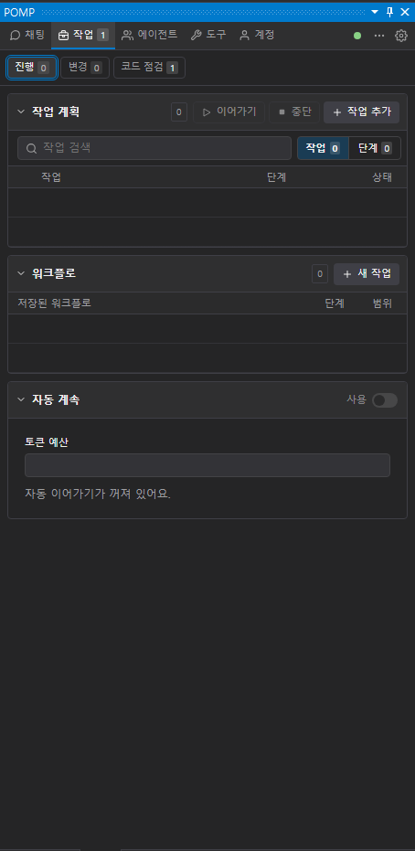
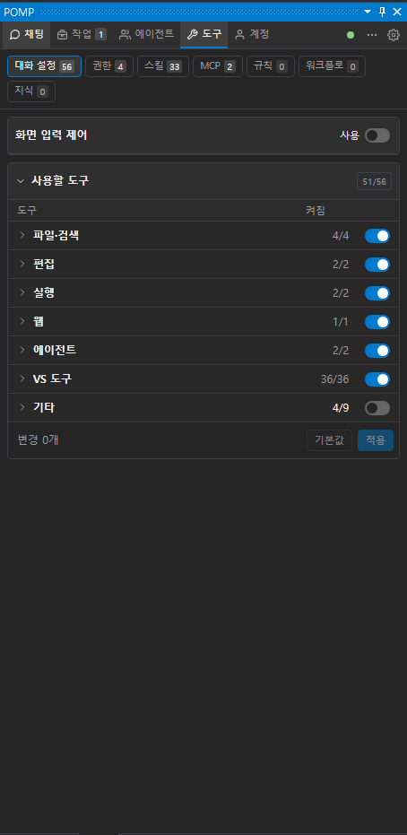

# POMP 화면 가이드

Visual Studio 2019에서 POMP를 쓰는 화면을 영역별로 설명한다. 처음 쓰는 순서는 [빠른 시작](quick-start.md)에 있다.

## 1. 전체 모습

왼쪽은 평소의 코드 편집기이고, 오른쪽이 **POMP 도구 창**이다. 다른 도구 창처럼 원하는 위치에 붙이거나 띄울 수 있다.

### 탭 막대

POMP 창 맨 위에 **채팅 · 작업 · 에이전트 · 도구 · 계정** 탭이 있다. 창이 좁으면 탭은 아이콘만 보이고, 이름은 툴팁으로 나온다.

탭 막대 오른쪽에는 다음 항목이 있다.

| 항목 | 하는 일 |
|---|---|
| 연결 상태 점 | 초록은 연결됨, 노랑은 시작 중이거나 공급자 연결이 필요함, 빨강은 실패다. 빨강일 때 누르면 다시 연결한다. |
| `⋯` | 로그 보기, 다시 시작 |
| `⚙` | 도구 > 옵션 > Pomp를 연다. |

### AI 설명 단추

편집기의 선언 위에 보이는 작은 **AI 설명** 단추는 코드 캡션 기능이다. 코드 캡션은 기본으로 꺼져 있고, POMP 메뉴에서 켠다.

단추를 누르면 보조 모델이 그 선언을 한 문장으로 설명해 단추 옆에 붙인다. 모델은 단추를 누를 때만 부른다.

### 탭 화면의 공통 구성

작업·에이전트·도구 탭은 하위 화면으로 나뉜다. 하위 화면 칩에는 항목 수가 붙는다. 0개인 칩은 흐리게 보이지만 눌러서 열 수 있다.

이 대화에서 아직 하위 화면을 직접 고르지 않았고 지금 화면이 비어 있으면, 항목이 있는 첫 화면이 열린다. 직접 고른 화면은 이 대화에서 계속 유지된다.

화면 안의 요소는 다음처럼 생겼다.

- 각 구역은 카드이고, 목록은 열 이름이 있는 표다.
- 켜기·끄기는 스위치, 상태는 색 배지로 보인다.
- 줄의 편집·삭제·열기 같은 동작은 줄 끝 아이콘이다. 아이콘 이름은 툴팁으로 보인다.
- 길어질 수 있는 목록에는 검색이 있고, 20개씩 페이지로 나뉜다.
- 빈 목록은 열 이름과 빈 줄만 보인다. 따로 안내 문구는 없다.
- **+ 새 역할**, **+ 새 규칙** 같은 추가 버튼은 카드 머리에 있다.
- 파일 목록과 적용된 변경 기록처럼 화면 밖에서 바뀔 수 있는 목록에는 새로 고침이 있다.

## 2. 편집기 우클릭 메뉴

코드 편집기에서 우클릭하면 VS 기본 항목 아래에 POMP 항목 두 개가 있다. VS 기본 항목은 빠른 작업, 이름 바꾸기, Using 제거 및 정렬 같은 것이다. POMP 항목은 **POMP에게 질문**과 **POMP** 하위 메뉴다.

| 항목 | 단축키 | 하는 일 |
|---|---|---|
| POMP에게 질문 | `Alt+M` | 질문 창을 연다. 아래 [질문 창](#질문-창)을 본다. |
| POMP ▸ 이 코드 설명 | `Shift+Alt+E` | 선택한 코드의 설명을 채팅으로 요청한다. 답만 받는다. |
| POMP ▸ 이 코드 리뷰 | `Shift+Alt+R` | 문제 목록만 받는다. 코드는 바꾸지 않는다. |
| POMP ▸ 이 코드 고치기 | `Shift+Alt+F` | 원인 설명과 변경 제안을 받는다. |
| POMP ▸ 테스트 작성 | `Shift+Alt+U` | 선택한 코드의 단위 테스트를 이 솔루션의 테스트 방식대로 변경 제안으로 받는다. |
| POMP ▸ 컨텍스트 바구니에 추가 | `Shift+Alt+I` | 현재 파일을 입력창 위 컨텍스트 바구니에 넣는다. 다음 메시지에 함께 붙는다. |
| POMP ▸ 지식에 추가 | `Alt+/` | 선택한 줄을 지식에 넣는 양식을 연다. 아래 [지식에 추가](#지식에-추가)를 본다. |
| POMP ▸ 에이전트·팀에게 ▸ 이름 | 없음 | 그 상대를 보낼 대상으로 잡고 채팅 입력창을 연다. 아래 [에이전트와 팀에게 보내기](#에이전트와-팀에게-보내기)를 본다. |
| POMP ▸ POMP 열기 | `Shift+Alt+Q` | 채팅 창을 연다. |
| POMP ▸ 새 대화 | `Shift+Alt+N` | 새 대화를 시작한다. |
| POMP ▸ 포커스 전환 | `Alt+J` | 편집기와 채팅 사이에서 포커스를 옮긴다. |
| POMP ▸ 인라인 자동완성 | 없음 | 켜고 끈다. 기본 꺼짐. |
| POMP ▸ 코드 캡션 | 없음 | 켜고 끈다. 기본 꺼짐. |
| POMP ▸ 변경 내용 표시 | 없음 | 체크 항목이고 기본 켜짐이다. 끄면 Live 변경 표시를 모두 숨기고, 다시 켜면 그대로 보인다. |
| POMP ▸ 변경 내용 지우기 | 없음 | 지금 대화의 변경 표시를 모든 파일에서 지운다. 코드는 그대로다. |
| POMP ▸ POMP 책갈피 정리 | 없음 | 이번 VS 실행에서 POMP가 남긴 책갈피를 지운다. |

표의 단축키는 모두 도구 › 옵션 › Pomp › 일반 › 단축키에서 바꾼다.

인라인 자동완성과 코드 캡션은 켜면 모델 비용이 생길 수 있다. 그림은 둘 다 켠 상태다.

Live 따라가기와 북마크 켜기·끄기는 이 메뉴에 없다. 채팅 입력창 위 아이콘에 있다. [Live와 북마크](#live와-북마크)를 본다.

### 질문 범위

설명·리뷰·고치기·테스트 작성과 **POMP에게 질문**은 블록으로 선택한 범위를 그대로 쓴다.

선택이 없으면 보내기 전에 편집기에서 범위를 직접 선택해 보여 준다. 범위는 이렇게 정한다.

- C#·VB 파일에서는 커서를 감싸는 가장 안쪽 멤버를 잡는다. 메서드, 생성자, 속성, 연산자, 이벤트, 로컬 함수가 멤버다.
- 멤버 밖이거나 C#·VB가 아닌 파일이면 커서 줄을 잡는다. 앞뒤 공백은 뺀다.
- 클래스 전체는 잡지 않는다.
- 멤버 밖의 빈 줄이면 아무것도 선택하지 않는다.

한 줄만 묻고 싶으면 그 줄을 블록으로 잡는다.

긴 멤버는 보내는 글이 옵션 **편집기 문맥 선택 글 최대 글자 수**에서 잘린다. 기본값은 2000자다. 줄 번호 범위는 그대로 가므로 에이전트가 파일에서 나머지를 읽을 수 있다.

### 질문 창

질문 창은 VS 테마 색으로 그려진다. 선택한 코드에 대해 채팅으로 질문하거나, 같은 창에서 그 자리의 수정 제안을 받는다. 고칠 수 없는 파일에서는 수정 제안이 꺼진다.

| 버튼 | 키 | 하는 일 |
|---|---|---|
| 채팅으로 질문 | `Enter` | 질문을 채팅으로 보낸다. |
| 채팅 입력창으로 | `Shift+Enter` | 질문을 보내지 않고 채팅 입력창으로 옮긴다. |
| 코드 수정 제안 | `Ctrl+Enter` | 그 자리의 수정 제안을 받는다. |
| 취소 | `Esc` | 창을 닫는다. |

버튼에는 단축키가 표시되지 않는다.

수정 제안은 작업 탭 › 변경의 **변경 제안**으로 간다. 승인해야 코드가 바뀐다.

### 인라인 자동완성

인라인 자동완성을 켜면 입력을 멈췄을 때 흐린 제안이 보인다.

| 키 | 동작 |
|---|---|
| `Tab` | 제안을 받는다. |
| `Ctrl+→` | 한 단어만 받는다. |
| `Esc` | 제안을 닫는다. |

### 지식에 추가

선택한 줄을 담아 도구 탭 › 지식의 **지식에 추가** 양식을 연다. 선택이 없으면 커서 줄을 담는다.

- 이름을 입력하면 그 글자가 들어간 지식이 최대 8개 보인다. 이름 칸이 비어 있으면 최근 지식이 보인다.
- 목록에서 고르거나 같은 이름을 입력하면 그 지식에 조각으로 들어간다.
- 없는 이름이면 색과 범위를 정해 새 지식이 된다.

넣은 줄은 그 지식의 색으로 줄 배경이 칠해진다. 지식은 [도구 탭](#8-도구-탭)에서 관리한다.

### 에이전트와 팀에게 보내기

**POMP ▸ 에이전트·팀에게** 메뉴는 에이전트·팀 수에 따라 다르게 보인다.

- 8개 이하면 모두 나온다.
- 더 많으면 이 작업 영역에서 최근에 보낸 상대가 최근 순으로 최대 7개 나온다. 그 아래에 **에이전트·팀 찾기**가 있다.
- 하나도 없으면 "(없음)"이 보인다.

**에이전트·팀 찾기**를 누르면 채팅의 보낼 대상 목록이 열린다. 10개가 넘으면 목록에 검색 칸이 있다. 에이전트·팀이 아무리 많아도 메뉴 길이는 그대로다.

상대를 고르면 채팅 입력창이 열린다. 보낼 대상 칩에는 그 상대의 그림과 이름이 보이고, 편집기 컨텍스트는 켜진 상태다.

## 3. 채팅 탭

위에서부터 대화 머리, 대화 상대 탭, 대화 내용, 컨텍스트 묶음, 입력창, 입력 막대, 사용량 막대가 있다.

### 대화 머리

| 항목 | 하는 일 |
|---|---|
| 대화 이름 | 누르면 그 자리에서 이름을 고친다. |
| `▾` | 전체 대화 목록을 연다. 검색, 전환, 미리보기, 삭제를 한다. |
| `+` | 새 대화를 시작한다. |

이름 고치기는 탐색기의 파일 이름 바꾸기와 같다. `Enter`를 누르거나 다른 곳을 누르면 저장된다. `Esc`는 바꾸지 않고 끝낸다. 저장·취소 단추는 없다. 이름을 비우거나 그대로 두면 바뀌지 않는다.

대화 목록은 대화 위에 펼쳐지는 드롭다운이다. 목록 밖을 누르거나, `▾`를 다시 누르거나, `Esc`를 누르거나, 대화를 고르면 닫힌다. 닫기 단추는 없다.

대화가 10개를 넘을 때만 맨 위에 검색 칸이 나온다. 목록을 열면 키보드가 검색 칸으로 간다. 검색 칸이 없으면 지금 대화 줄로 간다.

삭제는 한 번 더 확인한 뒤 대화 파일을 휴지통으로 옮긴다. 지금 대화를 지우면 새 대화가 먼저 시작된다.

### 대화 상대 탭

`기본 (POMP)` 탭과 그 오른쪽에 연 에이전트·팀 탭이 있다. 활성 탭이 지금 대화하는 상대다. `+`로 탭을 추가하고 `×`로 닫는다. 자세한 내용은 [에이전트 대화 상대 탭](#5-에이전트-대화-상대-탭)에 있다.

### 대화 내용

| 요소 | 설명 |
|---|---|
| 질문 카드 | 보낸 메시지다. 아래 칩은 함께 보낸 편집기 위치다. 예: `OrderService.cs · 20–43행`. 툴팁에 전체 경로가 보인다. |
| 생각 | 모델의 추론 과정이다. 접혀 있다. |
| 도구 카드 | 도구 호출 하나가 한 줄 카드로 나온다. `>`로 펼친다. |
| 명령 작업 | 모델이 요청해 승인받은 명령 작업은 그 도구 카드 안에 상태, **출력**, **취소**가 나온다. |
| 에이전트·팀 작업 카드 | 구성원별 상태와 **중지**가 나온다. |
| 답변 | 마크다운으로 표시된다. |

위로 스크롤하면 오른쪽 아래에 맨 아래로 가는 화살표 버튼이 나타난다.

### 컨텍스트 묶음

입력창 바로 위 줄이다. 왼쪽부터 다음 항목이 있다.

| 항목 | 하는 일 |
|---|---|
| `@` | 멘션을 넣는다. |
| `/` | 명령 목록을 연다. 명령을 고르면 맨 앞의 명령만 바뀌고 쓰던 글은 그대로 남는다. |
| 클립 | 파일을 첨부한다. |
| 클립 옆 숫자 | 컨텍스트 바구니에 든 항목 수다. 이 항목들이 다음 메시지에 붙는다. |
| 북마크 | 수정 위치에 책갈피를 남기는 토글이다. |
| Live | 수정 위치를 따라가는 토글이다. |
| 편집기 컨텍스트 포함 | 편집기 컨텍스트를 메시지에 함께 보낼지 켜고 끈다. `Alt+'`로도 바꾼다. |
| 사용량 막대 | 컨텍스트 창 사용량이다. |

`Alt+'` 같은 단축키는 옵션에서 바꿀 수 있다.

### 컨텍스트 사용량 막대

막대는 컨텍스트 창을 얼마나 썼는지 보인다. 예: `5% · 12.3k / 272k`. 70%에서 노랑, 90%에서 빨강으로 바뀐다.

막대는 출처별 색 구간으로 나뉜다. 순서는 늘 같다.

1. 시스템 프롬프트
2. 도구
3. MCP 도구
4. 규칙·컨텍스트 파일
5. 스킬
6. 대화

그 뒤의 빗금 구간은 다음 메시지에 붙을 바구니의 예상치다. 바구니에는 편집기 컨텍스트와 첨부 목록이 들어간다.

막대를 누르거나 `Enter`·`Space`를 누르면 출처별 토큰 수와 비율 목록이 열린다. 목록 위의 가는 막대는 창 크기와 관계없이, 쓴 양이 어떻게 나뉘는지 보인다.

값은 POMP가 실제로 센 것이다. MCP와 바구니만 추정이며 `≈`가 붙는다. 대화 토큰을 세지 않는 모델에서는 대화 행도 추정이다.

출처별 값을 얻지 못하면 막대는 한 색으로만 채워진다. 값은 응답이 끝날 때마다 다시 잰다.

### 컨텍스트 바구니

바구니는 입력창 위에 펼쳐지고, 위에서부터 다음이 있다.

| 부분 | 내용 |
|---|---|
| 요약 줄 | 입력과 경로의 예상 토큰 범위. 옆의 **토큰 계산**은 초안, 첨부 파일 목록, 선택한 지식을 모델의 토크나이저로 센다. 토크나이저를 쓸 수 없으면 `≈` 추정치다. |
| 첨부 파일 | 접고 펼 수 있는 묶음이다. 줄마다 순서 번호, 끌어서 순서 바꾸기, 경로, **×**가 있다. **×**를 누르면 바로 빠진다. |
| 지식 | 접고 펼 수 있는 묶음이다. 체크한 지식은 이 대화의 모든 메시지에 함께 간다. 기본 지식은 처음부터 체크되어 있다. |

파일은 편집기 우클릭 **POMP ▸ 컨텍스트 바구니에 추가**, 클립 버튼, 붙여넣기로 넣는다. 첨부 파일은 내용이 아니라 경로 목록으로 다음 메시지 하나에만 붙고, 보내면 바구니에서 빠진다. 모델은 필요한 파일을 직접 읽는다.

`Alt+;`로 바구니를 열면 첫 첨부 파일에 커서가 간다. `Esc`를 누르면 입력창으로 돌아간다.

바구니의 파일을 쓰는 명령은 [채팅 명령](#채팅-명령)에 있다.

### Live와 북마크

컨텍스트 묶음의 **북마크**와 **Live** 아이콘은 서로 따로 켜고 끄는 토글이다. 둘 다 기본으로 꺼져 있다.

| 토글 | 기본 단축키 | 하는 일 |
|---|---|---|
| Live | `Alt+L` | 에이전트가 적용한 수정 위치를 편집기에서 따라간다. |
| 북마크 | `Alt+K` | 화면을 옮기지 않고 수정 위치에 `pomp:` 책갈피를 남긴다. |

- 단축키는 도구 › 옵션 › Pomp › 단축키에서 바꾸거나 비울 수 있다.
- 토글 상태는 도구 › 옵션 › Pomp › 편집기의 같은 설정에 저장되고, 바로 맞춰진다.
- 누르거나 단축키를 써도 입력창 포커스는 그대로다.
- POMP가 이 기능의 상태를 받기 전에는 토글이 비활성이다.
- 바꾸지 못하면 VS 아래쪽 상태 표시줄에 알린다.
- 어느 토글도 모델을 부르거나 엔진을 다시 시작하지 않는다.

### Live 따라가기

Live를 켜면, 편집이 적용된 뒤 잠시 다음 편집이 없을 때 그 편집의 첫 변경 줄로 캐럿을 옮긴다. 그 줄은 화면 가운데에 온다. 편집이 연달아 오면 마지막 편집 위치로 간다.

- 편집기에 포커스가 있거나 IME로 입력 중이면 옮기지 않는다.
- 그 파일에 선택이 있으면 화면만 옮기고, 캐럿과 선택은 그대로 둔다.
- 채팅에서 작업 중이면 키보드 포커스를 가져오지 않는다.

### Live 변경 표시

에이전트가 바꾼 곳은 편집기에 두 가지로 표시된다. 옵션에서 각각 켜고 끄며, 둘 다 기본으로 켜져 있다.

| 표시 | 모양 |
|---|---|
| 줄 배경색 | 추가·수정된 줄에 옅은 초록 배경 |
| +/− 표시 | 변경마다 첫 줄에 초록 `+` 또는 빨강 `−` 단추 하나 |

- +/− 단추 위치는 옵션 **Live 변경 +/− 표시 위치**로 고른다. 코드 끝 오른쪽이나 줄 번호 옆 왼쪽 칸이다.
- 줄 배경색을 끄면 여러 줄 변경의 둘째 줄부터 줄 끝에 `+`가 더 붙는다.
- 편집기 세로 스크롤바에도 같은 색으로 변경 위치가 표시된다.

편집기 우클릭 **POMP › 변경 내용 표시**는 배경색, +/− 표시, 스크롤바 표시를 한꺼번에 끄고 켠다. 변경 기록은 남고, 상태는 같은 옵션에 저장된다.

표시가 남는 기간은 옵션 **Live 변경 내용 유지**로 고른다.

| 값 | 표시가 남는 기간 |
|---|---|
| 마지막 수정 요청만 | 마지막 수정 요청의 변경만 보인다. 기본값이다. |
| 파일을 저장할 때까지 | 파일을 저장하면 사라진다. |
| 대화 동안 모두 | 대화 동안의 변경이 모두 남는다. |

변경 기록은 실행 중인 VS의 메모리에 대화별로 보관된다. 대화를 바꾸면 그 대화의 변경 표시가 보인다.

### 비교 창과 원복

`+`나 `−`를 누르면 비교 창이 열린다.

- **이전** 칸은 빨강 테두리와 제목이고, **이후** 칸은 초록 테두리와 제목이다.
- 바뀐 줄 위아래로 2줄씩 함께 보인다.
- 내용이 없던 쪽에는 "(없던 내용 — 새로 추가됨)" 또는 "(삭제됨)"이 보인다.
- 두 칸은 옵션 **Live 변경 비교 창 배치**로 위아래 또는 좌우로 놓는다. 기본은 위아래다.
- 긴 줄은 줄바꿈하지 않고 가로로 스크롤한다.

비교 창 안의 **원복**으로 그 변경을 되돌린다. 비교 창 밖에 따로 원복 단추는 없다.

**원복**은 그 구간을 이 대화에서 처음 수정하기 직전 내용으로 되돌린다.

- 추가된 줄은 지우고, 삭제된 줄은 되살린다.
- 다른 구간에서 사용자가 고친 내용은 그대로 둔다.
- 그 구간이나 삭제 주변을 사용자가 고쳤으면 덮어쓰지 않고 원복을 거부한다.
- 자동으로 저장하지 않는다. VS의 실행 취소·다시 실행으로 되돌릴 수 있다.

### POMP 책갈피

북마크를 켜면 VS 책갈피 창에 대화마다 **POMP · &lt;대화 제목&gt;** 폴더가 생긴다. 제목이 없으면 대화 시각이 폴더 이름이 된다. 요청마다 파일별 첫 변경 줄에 `pomp:` 책갈피가 남는다.

POMP 책갈피는 토글을 끄거나 대화를 바꿔도 지워지지 않는다. 직접 지우거나 편집기 우클릭 **POMP › POMP 책갈피 정리**를 쓴다.

정리는 이번 VS 실행 중에 POMP가 추가한 책갈피만 지운다. 그래서 비게 된 POMP 폴더도 지운다. 사용자 책갈피와 폴더, 사용자가 POMP 폴더에 넣은 항목은 남는다.

### 입력창

| 키 | 동작 |
|---|---|
| `Enter` | 보낸다. |
| `Shift+Enter` | 줄을 바꾼다. |
| 빈 입력창에서 `↑` | 이전에 보낸 입력을 불러온다. |
| 빈 입력창에서 `↓` | 그다음 입력을 불러온다. 마지막을 지나면 다시 빈 입력창이 된다. |
| `Ctrl+V` | 복사한 파일이나 그림을 바구니에 넣는다. |
| `Tab` | 입력 예측 문장을 받는다. |

옵션 `단축키 > 보내기`를 `Ctrl+Enter`로 바꾸면 `Ctrl+Enter`가 보내기, `Enter`가 줄바꿈이 된다.

`↑`와 `↓`는 입력창이 비어 있을 때만 동작한다. 쓰던 글은 바꾸지 않는다.

탐색기나 솔루션 탐색기에서 복사한 파일, 캡처한 그림을 붙여넣으면 글 대신 바구니에 들어간다. 그림은 작업 영역의 `.pomp\local\clipboard`에 PNG로 저장된다.

옵션 **입력 예측 문장**을 켜면, 입력을 멈췄을 때 이어질 문장이 커서 뒤에 흐리게 보인다. `Tab`으로 받고, `Esc`나 다른 입력으로 사라진다.

오른쪽 `↑` 단추가 보내기다. 응답 중에는 `■` 중지 단추와 대기열 추가가 나온다.

### 입력 막대

입력창 아래 줄이다. 왼쪽부터 다음 칩이 있다.

| 칩 | 하는 일 | 단축키 |
|---|---|---|
| 권한 모드 | `항상 묻기` · `쓰기 자동` · `모두 자동` 중 고른다. | `Alt+Q`로 목록을 연다. |
| 보낼 대상 | 메시지 하나만 다른 에이전트·팀이나 POMP에 보낼 때 고른다. | `Ctrl+Alt+T`로 목록을 연다. |
| 모델 | 채팅 모델을 고른다. | |
| 뇌 아이콘 | 추론 단계를 고른다. | |
| 번개 | fast 모드를 켜고 끈다. | |

단축키는 옵션에서 바꿀 수 있다. 채팅 모델과 추론 단계는 이 칩에서만 고른다.

막대는 입력창 너비를 채운다. 자리가 모자라면 모델 이름이 줄어들고, 긴 대화 상대 이름은 잘린다.

지금 모델이 fast를 지원하지 않으면 번개는 흐리게 남는다. 번개의 툴팁은 Fast 모드 켜짐, 꺼짐, 이 모델 미지원 중 하나를 보인다.

화면 입력 제어는 입력 막대가 아니라 **도구 › 대화 설정**에 있다.

### 권한 모드

- `모두 자동`을 고르면 확인 질문을 거친다.
- 모드를 바꾸면 POMP가 다시 시작되고 대화는 복구된다.
- 응답 중에는 바꿀 수 없다.

모드마다 무엇을 묻는지는 [승인 카드](#4-승인-카드)와 [설정 안내](settings.md)의 승인 모드에 있다.

### 보낼 대상

칩은 평소 사람 아이콘과 `보낼 대상`을 보인다. 상대를 고르면 칩이 그 상대의 그림과 이름으로 바뀐다.

- 지금 보고 있는 대화 자신은 칩에 나오지 않는다.
- 칩, 대상 목록, `@` 목록의 그림은 에이전트 탭에서 정한 모양·색·이미지다.
- 팀은 구성원 그림을 최대 3개 겹쳐 보인다.
- 고른 대상이 사라지면 대상이 풀린다. 역할이나 팀을 지웠거나 구성원이 끝난 경우다. 이때 VS 상태 표시줄에 알린다.

대상 목록은 이렇게 보인다.

- 순서는 **팀**, **에이전트**, **이 대화에서 실행한 에이전트**이다. 묶음 안은 이름순이다.
- 지금 보고 있는 대화는 자기 묶음 맨 위에 배경색으로 표시된다. 기본 탭이면 `기본 (POMP)`, 에이전트·팀 탭이면 그 에이전트·팀이다.
- `기본 (POMP)`는 기본 탭과 팀 탭에서는 에이전트 묶음 맨 위에 온다. 에이전트 탭에서는 그 에이전트 바로 아래에 온다.
- 지금 대화의 줄을 고르면 고른 대상이 풀린다. 다음 메시지는 서브에이전트가 아니라 지금 대화로 이어진다.
- 고른 대상은 배경색과 왼쪽 막대로 보인다.

`Alt+,`와 `Alt+.`는 목록의 이전·다음 대상으로 바로 바꾼다. 목록 양 끝을 지나면 대화 상대로 돌아온다.

### 상태 표시줄 알림

입력 막대, 대화 머리, 대화 상대 탭, 대기열의 알림은 화면 안에 글로 끼워 넣지 않는다. 모두 VS 아래쪽 상태 표시줄에 `POMP: <알림 내용>`으로 나온다. 오류와 경고는 POMP 로그에도 남는다.

이런 알림이 여기에 나온다.

- 모델, 추론 수준, 권한 모드를 바꾸지 못함
- 메시지를 보내지 못한 이유, 첨부 경고
- 대화 이름 바꾸기나 대화 목록 요청 실패
- Live·북마크 변경 실패
- 대기열 작업 실패
- 에이전트 인스턴스를 새로 시작함

### 사용량 막대

맨 아래 줄이다. 한 공급자의 사용량 한도를 한 줄로 보인다. 한도 구간은 5시간과 주간이다.

- 공급자가 여럿이면 공급자 이름과 양옆에 `‹` `›`가 생긴다. 현재 모델의 공급자부터 보이고, 화살표로 다른 공급자로 넘긴다.
- 모델을 바꾸면 그 모델의 공급자로 돌아온다.
- 한 줄에 들어가는 만큼 한도를 보이고, 나머지는 `+N`으로 센다.
- 공급자가 보고하지 않은 구간은 표시하지 않는다.
- 막대를 누르면 구독별 사용량 전체가 열린다. `↻`로 새로 고친다.
- 한도의 초기화 시각이 되면 그 구간은 0%로 바뀐다. 응답 중이 아니면 새 사용량을 바로 받아 온다.

### 채팅 우클릭 메뉴

채팅 창에는 뒤로, 새로 고침, 인쇄 같은 웹 페이지용 메뉴가 나오지 않는다. 우클릭한 곳에 따라 다음 메뉴가 나온다.

| 우클릭한 곳 | 메뉴 |
|---|---|
| 메시지 | **메시지 복사**, 선택한 글이 있으면 **선택 영역 복사** |
| 코드 블록 | **코드 복사**, 가능할 때 **검토로 보내기** |
| 첨부 칩 | **경로 복사** |
| 컨텍스트 바구니 항목 | **경로 복사**, **제거** |
| 입력창 | 잘라내기, 복사, 붙여넣기 같은 편집 메뉴 |
| 입력창 둘레의 빈 곳 | **보일 버튼** 메뉴 |

지난 대화를 열어 복원한 메시지에도 같은 메뉴가 나온다.

**보일 버튼** 메뉴에서는 다음 버튼을 체크로 보이거나 숨긴다.

`@` 멘션, `/` 명령, 파일 첨부, 컨텍스트 바구니, 북마크, Live, 편집기 컨텍스트 포함, 컨텍스트 사용량, 권한 모드, 보낼 대상, 모델, 추론 수준, 빠른 모드, 구독 사용량.

- 하나라도 숨겼으면 **모두 표시**가 붙는다.
- 숨겨도 단축키, 슬래시 명령, 그 기능은 그대로 쓸 수 있다.
- 선택은 이 PC에 기억되고, 모든 대화와 대화 상대 탭에 같이 적용된다.

키보드로는 `Shift+F10`이나 메뉴 키로 열고, 방향키와 `Enter`, `Esc`로 쓴다.

### 채팅 명령

입력창에 `/`를 치거나 `/` 버튼을 누르면 명령 목록이 열린다. 같은 일을 하는 명령은 쉬운 이름 하나로만 나온다.

#### 채팅 화면이 직접 처리하는 명령

| 명령 | 하는 일 |
|---|---|
| `/new` | 새 대화 |
| `/sessions` | 대화 목록 |
| `/rename` | 대화 이름 바꾸기 |
| `/effort` | 추론 단계 고르기 |
| `/permissions` | 입력 막대의 권한 모드 목록 열기 |
| `/compact [지침]` | 대화 압축 |
| `/agent 이름 메시지` | 그 에이전트에게 메시지 보내기 |
| `/team 이름 메시지` | 그 팀에게 메시지 보내기 |
| `/goal 목표` | 목표를 자동으로 이어서 실행. 아래 `/goal`을 본다. |

`/model`, `/thinking`, `/accounts`, `/login`, `/usage`, `/work`, `/agents`, `/computer`, `/help`도 이 묶음이다.

#### POMP의 명령

| 명령 | 하는 일 |
|---|---|
| `/workflow 작업` | 단계별 워크플로 시작 |
| `/plan 작업` | 계획만 세우기. 아래 `/plan`을 본다. |
| `/map [초점]` | 코드베이스 구조 지도 설명 |
| `/review [초점]` | 소스 검토 |
| `/max` | 컨텍스트 100만 토큰 모델 고르기 |
| `/guard` | 저장 안 한 VS 변경 가드 |
| `/vs-status` | VS 연결 상태 |
| `/skill 이름` | `.pomp`의 스킬 불러오기 |
| `/command 이름` | `.pomp`의 명령 불러오기 |
| `/recipe 이름` | `.pomp`의 레시피 불러오기 |

`/rules`와 `/resources`도 이 묶음이다. 직접 만든 명령이 같은 이름이면 직접 만든 명령이 그 이름을 쓴다.

다음 명령은 바구니의 파일을 함께 받아 그 파일들만 다룬다. 보내면 바구니가 비워진다.

- `/workflow`, `/plan`, `/map`, `/review`, `/skill`, `/command`, `/recipe`
- 스킬
- 직접 만든 프롬프트 파일 명령

그 밖의 명령은 바구니를 쓰지 않고 그대로 둔다.

#### 그 밖의 명령

| 명령 | 하는 일 |
|---|---|
| `/context` | 컨텍스트 사용량 |
| `/fast` | 빠른 모드 |
| `/tools` | 사용할 수 있는 도구 |
| `/mcp` | MCP 서버 관리 |

직접 만든 명령과 MCP 프롬프트도 이름만으로 나온다.

#### 스킬 명령

목록 맨 아래 **스킬** 머리 아래에 켜 둔 스킬이 `/이름`으로 나온다. 기본, 사용자, 프로젝트 스킬이 모두 해당한다.

같은 이름의 명령이 있으면 명령이 이기고, 스킬은 `/skill:이름`으로 남는다. 도구 › 스킬에서 끈 스킬은 나오지 않는다.

#### /plan

`/plan 작업`은 계획만 세운다.

- 이번 응답에서 모델은 읽기, 검색, 웹 조회, 계획 도구만 쓸 수 있다. 계획은 작업 탭 › 진행에 나온다.
- 파일 편집, 명령 실행, 하위 에이전트 시작, VS 편집 도구는 거부된다.
- 응답이 끝나면 제한이 풀린다. 모델이 스스로 풀 수는 없다.

계획은 작업 탭 › 진행 › 작업 계획에서 고치고 **이어가기**로 실행한다. `/goal`이나 자동 계속으로 이어 갈 수도 있다.

작업 없이 `/plan`만 치면 입력창에 오류가 보인다. 모델에게 "계획만 세워 줘"라고 말해도 모델이 같은 제한을 걸 수 있다.

#### /goal

`/goal 목표`는 워크플로를 시작하고, 그 워크플로에 **자동 계속**을 켠다. 자동 계속은 최대 6회이고, 토큰 예산을 정할 수 있다.

실행마다 모델 사용 비용이 들므로, 먼저 채팅 안에 **목표 실행** 카드가 나온다.

| 카드 항목 | 설명 |
|---|---|
| 목표 글 | 고칠 수 있다. 목표 글 안에서 `Shift+Enter`는 줄바꿈이다. |
| 토큰 예산 | 비우면 예산이 없다. |
| 질문 | "이 목표를 자동으로 이어서 실행할까요?" |
| **시작** / **취소** | `Enter`가 시작, `Esc`가 취소다. |

- 카드가 나온 직후 잠깐은 키를 받지 않는다.
- 응답 중에는 **시작**이 눌리지 않는다.
- 시작하면 채팅에 `/goal 목표`가 보인다. 워크플로가 만들어지면 자동 계속이 켜졌다는 알림이 나온다.
- 진행 중인 워크플로가 있거나, 응답 중이거나, 워크플로 명령을 쓸 수 없으면 시작하지 않는다. 카드에 이유가 보인다.
- 토큰은 목표를 시작한 때부터 센다. 첫 실행도 목표에 들어간다.
- 모델에게 "이 목표를 알아서 계속해 줘"라고 말해도 같은 카드가 나온다. 카드에서 시작하기 전에는 아무것도 시작하지 않는다.
- 에이전트·팀 탭에서는 쓸 수 없다.

### 케이스별 피드백

모델이 여러 방법, 시나리오, 테스트 케이스를 케이스로 나눠 보여 주면 그 답변 안에 **케이스 카드**가 차례로 나온다. 채팅에서 `/case-review`로 케이스로 나눠 보여 달라고 시킬 수도 있다.

카드마다 제목, 설명, **의견** 입력란이 있다. 작업 영역 안의 이미지나 다이어그램이 있으면 함께 보인다.

- 이미지는 작업 영역 안의 파일만 보여 준다. 인터넷에서 가져오지 않는다.
- 이미지를 불러오는 동안 "이미지를 불러오는 중"이 보인다. 읽지 못하면 이유와 **다시 시도**가 나온다.
- 다이어그램은 Mermaid로 화면 안에서만 그린다. 그릴 수 없으면 원문을 보여 준다.

의견을 적은 케이스만 보낸다.

- 답변 맨 아래 **의견 N개 보내기**가 적은 의견을 메시지 하나로 묶어 그 대화의 대기열에 넣는다.
- 의견을 비운 케이스는 보내지 않는다. 모델은 빈 의견을 승인으로 보지 않는다.
- 보낸 메시지는 채팅에 "케이스 의견 N개"와 케이스 제목, 의견으로 보인다. 대기열과 대화 목록 미리보기에는 한 줄 요약으로 보인다.

적는 중인 의견은 잠시 뒤 저절로 초안으로 저장된다. 대화를 다시 열어도 남아 있다. 보낸 뒤에는 카드가 읽기 전용이 된다.

보내기는 파일 변경이나 명령 실행 승인이 아니다. 보낸 결과를 확인하지 못하면 중복을 막으려고 다시 보내지 않는다. 이때는 채팅과 대기열을 확인한다.

### 다시 연결할 때

같은 작업 영역에서 다시 시작하면 직전 대화를 확인해 복원을 시도한다. 확인이 끝나기 전에는 보낼 수 없다.

복원에 실패해도 표시된 기록은 지우지 않는다. **복원 재시도**, **다른 기록 열기**, **새 대화** 중에서 고른다.

화면 기록 보존과 대화 복원은 별개다. 실행 중이던 작업, 승인, 훅, 일시정지된 대기열은 자동으로 다시 시작하지 않는다.

### 작업 영역 신뢰

시작할 때 그대로 실행하거나 따르는 설정이 저장소에 있으면, 시작 전에 채팅 화면에 **이 저장소의 에이전트 설정을 신뢰할까요?** 카드가 나온다. 이때 탭 막대의 연결 점은 "신뢰 확인 필요"다.

카드 목록에는 파일마다 종류가 붙는다.

| 종류 | 내용 |
|---|---|
| 에이전트 설정 | 도구 자동 승인 등을 바꿀 수 있는 설정 |
| MCP 서버 | 서버 수가 함께 보인다. |
| 도구 코드 | 저장소 안의 도구 코드 |
| 언어 서버 | 설정 파일과 `node_modules/.bin` 등 저장소 안 실행 파일 |
| 플러그인 | 저장소 안의 플러그인 |
| 바깥 파일 포함 | 작업 영역 밖 파일을 `@경로`로 끌어오는 `AGENTS.md` 같은 파일과 그 대상 |
| 확장 코드 | 옵션 "발견된 확장 불러오기"를 켰을 때만 나온다. |

역할, 규칙, 스킬처럼 지시문만 담은 파일은 묻지 않는다.

| 버튼 | 하는 일 |
|---|---|
| **파일 열기** | 그 줄의 파일을 VS에서 열어 내용을 확인한다. |
| **신뢰하고 시작** | 보이는 목록 그대로를 이 폴더에 대해서만 기억하고 시작한다. |
| **시작 안 함** | 시작하지 않고 카드를 남겨 둔다. 나중에 신뢰할 수 있다. |

- 파일이 바뀌거나 새로 생기면 다음 시작 때 다시 묻는다. git pull이나 에이전트의 수정도 해당한다.
- 목록을 보는 사이 파일이 바뀌었으면 신뢰하지 않고 바뀐 목록을 보여 준다.
- 도구 › MCP에서 직접 바꾼 MCP 서버는 이미 준 신뢰를 유지한다.
- 신뢰 해제는 도구 › 권한 › **신뢰한 저장소**에서 한다. 지금 쓰는 저장소를 해제하면 다시 시작되고 카드가 다시 나온다.
- POMP는 저장소 폴더가 아니라 POMP 데이터 폴더에서 시작한다. 그래서 저장소의 `.env` 파일은 설정에 쓰이지 않는다.

## 4. 승인 카드

에이전트가 무언가를 바꾸거나 실행하려 하면 대화 맨 아래에 승인 카드가 나온다. 다른 탭을 보고 있으면 채팅 탭에 점이 붙는다.

카드가 있는 동안에도 대화, 입력창, 다른 탭은 그대로 쓸 수 있다. 답하면 카드는 제목과 결과 한 줄로 대화에 남는다. 결과는 허용함, 거부함, 만료됨 등이다.

승인을 기다리는 동안에는 메시지를 보낼 수 없다. 다음 메시지 초안은 미리 써 둘 수 있다.

### 카드 구성

그림은 하위 에이전트에게 작업을 맡기는 승인 카드다.

| 부분 | 내용 |
|---|---|
| 제목과 배지 | 무엇을 하려는지, 종류 배지, 누가 묻는지, 도구 이름. 그림에서는 "하위 에이전트에게 작업 맡기기", `에이전트 실행`, `기본 도구`, `task`다. |
| 요약 | 맡길 에이전트, 작업 미리보기, 작업 수. 그림에서는 `검토` 에이전트다. |
| Diff | 파일 변경이면 나온다. 넓은 창에서는 나란히, 좁은 창에서는 한 줄씩 보인다. |
| 주의 문장 | 하위 에이전트 실행처럼 위험한 승인에만 한 줄 나온다. 허용하면 끝날 때까지 도구별로 다시 묻지 않는다는 뜻이다. |
| **전체 요청 내용 보기** | 모델이 보낸 원래 요청 전체를 보인다. |
| 거부 이유 | VS 도구의 카드에만 있는 입력란이다. |

버튼은 네 가지다.

| 버튼 | 적용 범위 |
|---|---|
| 허용(한 번) | 이번 요청만 허용한다. |
| 거부 | 이번 요청을 거부한다. |
| 항상 허용 | 이 작업 영역에서 그 도구의 모든 요청을 허용한다. |
| 이 세션 동안 허용 | 이 세션 동안 그 도구의 모든 요청을 허용한다. |

솔루션이나 폴더를 바꾸면 "이 세션 동안 허용"이 지워진다. 새 작업 영역에서 다시 연결될 때까지 들어온 요청은 거부된다.

### 답하는 키

| 키 | 답 |
|---|---|
| `Enter` | 허용(한 번) |
| `Esc` | 거부 |
| `Alt+A` | 허용. 어디서나 통한다. |
| `Alt+D` | 거부. 어디서나 통한다. |

- `Enter`와 `Esc`는 포커스가 카드에 있을 때 통한다. 빈 입력창이나 대화의 빈 곳에 있을 때도 통한다.
- 입력창에 쓰던 글이 있으면 `Enter`와 `Esc`는 그 글의 키로 남는다.
- 카드는 화면에 들어오면 포커스를 가져간다.
- 카드가 나타난 직후 잠깐은 어떤 입력도 답으로 받지 않는다.
- 대화를 위로 올려 카드가 화면 밖에 있으면, 카드는 포커스를 가져가지 않고 `Enter`·`Esc`도 받지 않는다. 이때는 `Alt+A`와 `Alt+D`만 통한다.

화면에는 단축키 설명이 없다. 단축키는 이 안내서와 [설정 안내](settings.md)에 있고, 도구 > 옵션 > Pomp > 일반 > 단축키에서 바꾼다.

### 매번 확인하는 요청

다음 요청은 허용을 기억하지 않는다. 이런 카드에는 허용(한 번)과 거부만 있다.

- 명령 실행
- Git 쓰기
- 패키지 변경
- 디버거, `debug` 포함
- 테스트 실행
- 하위 에이전트, `task`
- 컴퓨터·브라우저 사용
- 프로젝트 정책과 에이전트 설정 파일 수정. 예: `mcp.json`, `AGENTS.md`, `node_modules/.bin`

### 권한 모드와 승인

| 권한 모드 | 승인 카드 |
|---|---|
| `쓰기 자동` | VS 도구의 파일, 프로젝트, 중단점, 북마크 변경은 묻지 않는다. |
| `모두 자동` | 강제로 묻는 것과 화면·브라우저 조작만 묻는다. 강제로 묻는 것은 위험 명령의 사유와 공급자 안전 확인이다. |

### 확장이 묻는 질문

확장이 묻는 선택, 확인, 입력 질문도 같은 자리에 카드로 나온다.

- `Esc`는 취소다.
- `Enter`는 확인이나 선택한 항목이다.
- 글을 입력하는 질문에서 `Enter`는 입력칸으로 커서만 옮긴다.

## 5. 에이전트 대화 상대 탭

그림의 `검토` 탭은 검토 에이전트와 나눈 대화다. 질문 카드 위의 검토 그림과 이름이 메시지를 받은 상대다.

지난 대화를 다시 열면 접힌 전달 카드 머리에 같은 그림과 이름이 붙는다. `보낸 이 → 받은 이` 화살표는 에이전트·팀끼리 주고받은 메시지에만 쓴다.

### 메시지가 전달되는 과정

에이전트 탭에 보낸 메시지는 POMP가 그 에이전트를 하위 에이전트로 실행해 전달한다. 화면의 `task`와 `wait`가 그 과정이다.

- `task`는 검토 에이전트를 실행한다. 앞의 승인 카드가 이 요청이다.
- `wait`는 결과를 기다린다.
- `task` 아래 작업 카드에 구성원 상태와 최근 도구가 보인다. 예: `완료 · 4 개 도구 · 25.9s`.

그림에서 검토 에이전트는 다시 scout에게 확인을 맡겼다. 이때는 승인을 다시 묻지 않고, scout는 작업 카드에 구성원으로 보인다. 검토 에이전트는 결과를 받아 한 문장으로 답했다.

탭을 오가도 에이전트별 맥락은 이어진다. 연결이나 대화가 바뀌면 새로 시작한다.

### 이 탭에서 다른 상대에게 보내기

입력 막대의 대상 칩은 평소 `보낼 대상`이다. 메시지 하나만 다른 에이전트·팀이나 POMP에 보내려면 칩에서 고른다.

- 목록의 `검토` 줄은 이 대화 자신이라 배경색으로 구분된다. 고르면 다른 대상이 풀리고 이 대화로 이어서 보낸다. 검토를 서브에이전트로 다시 부르지 않는다.
- 이 대화에서 실행한 검토 구성원은 목록에서 빠진다.
- `/agent 검토 메시지`도 이 탭에서 평소처럼 검토에게 간다.
- 다른 상대에게 보낸 메시지와 그 답은 이 탭에 남는다. 메시지 위에 받은 상대의 그림과 이름이 보인다.
- 같은 메시지와 답은 받은 상대의 탭과 기본 탭에도 보인다.
- 대화를 다시 열거나 VS를 다시 시작해도 이 탭에 그대로 남는다.
- 보낸 뒤 칩은 `보낼 대상`으로 돌아온다.
- `/goal`은 기본 탭에서만 쓴다.

### 구성원 중지

그 상대의 작업 카드에서 구성원별 상태, 도구 수, 시간, 최근 도구와 **중지**를 본다.

**중지**는 같은 줄에서 한 번 더 확인한 뒤 그 구성원만 멈춘다. 다른 구성원과 메인 대화는 계속된다. 메인 대화는 취소된 결과를 받는다.

채팅 입력창의 중지는 전체 응답을 멈춘다.

## 6. 에이전트 탭

하위 화면은 **역할 · 팀 · 조언자 · 자동화**다. 실행 진행과 구성원별 중지는 채팅의 작업 카드와 에이전트·팀 대화 상대 탭에서 본다.

### 역할

**역할** 카드 하나에 모든 역할이 표로 나온다. 위에 검색과 범위 거르기가 있다. 범위는 **전체 · 프로젝트 · 사용자**이고 칸마다 개수가 붙는다. 목록은 20개씩 페이지로 나뉜다.

#### 역할 줄

줄마다 역할 그림, 표시 이름과 식별자, 설명 한 줄, 배지가 있다. 역할 그림은 기본으로 이름 첫 글자 동그라미다. 표시 이름은 역할 파일이 정한 그대로다.

| 배지 | 뜻 |
|---|---|
| **채팅 모델** · **빠른 모델** · 모델 이름 | 역할이 쓰는 모델 |
| 프로젝트 · 사용자 | 저장 범위. POMP에 들어 있는 역할에는 범위 배지가 없다. |
| **모든 도구** · **읽기 도구** · **직접 지정 도구** | 도구 범위 |
| **가려짐** | 같은 이름의 역할이 먼저 쓰여 이 역할은 쓰이지 않는다. 사용자, 프로젝트, POMP에 들어 있는 역할 순으로 먼저 쓰인다. |
| **VS에서 편집** | 화면의 편집 창으로 다시 쓸 수 없는 파일이다. |
| **파일 오류** | 파일에 오류가 있다. 설명 자리에 오류 내용이 보인다. |
| **모델 없음** | 지정한 모델의 공급자가 연결되지 않아 지금은 채팅 모델로 실행한다. |

줄 끝 아이콘은 역할 종류에 따라 다르다.

| 역할 종류 | 줄 끝 아이콘 |
|---|---|
| 편집 창으로 고칠 수 있는 역할 | 메시지 · 편집 · 삭제 |
| POMP에 들어 있는 역할 | 메시지 · 복제 · 편집 |
| 편집 창이 다룰 수 없는 파일 | 메시지 · VS에서 열기 · 삭제 |
| 형식 오류 파일 | VS에서 열기 · 삭제 |

편집 창이 다룰 수 없는 파일은 여러 줄 설정이 있는 파일이다. **메시지**는 그 역할의 대화 상대 탭을 연다. **삭제**는 한 번 더 확인한다.

#### POMP 줄

맨 위 줄은 **POMP**다. 대화창에서 사용자와 직접 일하는 에이전트 자신이다. **전체** 거르기에서만 나오고, 삭제할 수 없다.

배지는 **채팅 모델**과 **모든 도구**다. 지시가 있으면 그 범위 배지도 붙는다.

그림을 누르면 다른 역할처럼 그림 편집 창이 열린다. POMP 그림은 내 모든 프로젝트에 같이 쓰인다.

**편집**은 POMP 지시 편집 창을 연다. 저장 범위와 지시 사항을 정한다. 지시는 POMP의 시스템 프롬프트 끝에 붙는다.

| 저장 범위 | 저장되는 파일 |
|---|---|
| 이 프로젝트 | 저장소 루트의 `.omp/APPEND_SYSTEM.md` |
| 내 모든 프로젝트 | POMP 사용자 설정 폴더의 `APPEND_SYSTEM.md` |

- 지시를 비우고 저장하면 그 파일이 지워진다.
- 프로젝트 지시가 있으면 사용자 지시는 쓰이지 않는다. 편집 창에서 사용자 지시에 **가려짐**이 붙는다.
- 지시는 엔진이 시작할 때 읽는다. 그래서 바꾼 뒤에는 표 위에 **POMP 지시가 아직 적용되지 않았어요** 알림과 **다시 시작** 단추가 나온다. 다시 시작하면 알림이 사라진다.

#### 역할 그림

역할 그림을 누르면 그림 편집 창이 열린다.

| 항목 | 선택지 |
|---|---|
| 모양 | **원 · 둥근 사각형 · 사각형 · 육각형** |
| 색 | **자동**, 고정 색 동그라미, 끝의 **+** 동그라미 |
| 이미지 | **이미지 선택**, 제거 |
| 단추 | **기본값으로 · 취소 · 저장** |

**+** 동그라미는 색 고르기를 연다. 채도·밝기 영역, 색상 막대, HEX 칸으로 색을 고른다. 고른 색은 **+** 앞에 동그라미로 남는다.

#### 새 역할

**+ 새 역할** 편집 창은 템플릿에서 시작할 수 있다. 템플릿은 설계자, 구현자, 리뷰어, 테스터, 문서 작성자, 탐색자다.

편집 창에서 정하는 항목은 다음과 같다.

- 저장 범위: 이 프로젝트, 내 모든 프로젝트
- 표시 이름, 식별자 이름, 맡은 일, 설명, 지시 사항
- 모델: 채팅 모델과 같게, 빠른 모델, 특정 모델 선택
- 추론 단계
- 도구 범위: 모든 도구, 읽기 도구
- 지식: 고른 지식은 그 역할이 구성원으로 일할 때 늘 함께 간다.

지식은 저장할 때 적용된다. 지식 자체는 [도구 탭](#8-도구-탭)의 지식에서 관리한다.

#### POMP에 들어 있는 역할 복제와 편집

**복제**는 새 역할 편집 창을 연다. 이름은 `이름-copy`이고, 원래 역할의 이름, 설명, 모델, 추론 단계, 도구 범위가 채워져 있다. 지시문은 복사되지 않으니 직접 적는다.

**편집**은 그 역할의 설명, 지시문, 모델, 추론 단계, 도구를 채운 편집 창을 연다. 식별자는 바꿀 수 없다.

- 저장하면 고른 범위에 같은 이름의 역할 파일이 생기고, 원래 역할 대신 쓰인다. 원래 줄에는 **가려짐**이 붙는다.
- 그 파일을 삭제하면 원래 역할로 돌아간다.
- 도구를 직접 지정한 역할은 도구 범위에 **직접 지정 도구**가 있다. 그대로 두면 그 도구 목록이 유지된다.

### 팀

**팀** 카드 머리에 **가져오기**와 **+ 새 팀**이 있다. 검색과 20개씩 페이지가 있다.

#### 팀 줄

줄마다 팀 이름과 식별자, 목표, 배지, 구성원 동그라미가 있다. 목표가 없으면 구성원 순서가 보인다. 찾을 수 없는 구성원은 점선 경고로 표시된다.

| 배지 | 뜻 |
|---|---|
| 리더 판단 · 동시에 · 순서대로 | 진행 방식 |
| 프로젝트 · 사용자 | 저장 범위 |
| **격리** | 격리된 복사본에서 실행한다. |
| **가려짐** | 같은 이름의 팀이 먼저 쓰여 이 팀은 쓰이지 않는다. |
| **구성원 N명 없음** | 찾을 수 없는 구성원이 있다. |
| **파일 오류** | 파일에 오류가 있다. |

줄 끝 아이콘은 다음과 같다.

| 아이콘 | 하는 일 |
|---|---|
| **메시지** | 그 팀의 대화 상대 탭을 연다. 실행할 수 있는 팀에만 있다. |
| **편집** | 팀 편집 창을 연다. |
| **내보내기** | 팀을 글로 내보낸다. |
| **삭제** | 한 번 더 확인한 뒤 지운다. |

#### 팀 편집

| 항목 | 설명 |
|---|---|
| 저장 범위, 표시 이름, 팀 식별자, 팀 목표 | 팀의 기본 정보 |
| 구성원 | 2명 이상. 위로, 아래로, 빼기로 정리한다. 많으면 쪽을 넘긴다. |
| 역할 표 | 구성원 목록 아래에 있다. 검색해 **+** 단추로 추가한다. 8개씩 페이지로 나뉜다. |
| 진행 방식, 지시 사항 | 팀이 일하는 방식 |
| **구성원 외 에이전트 호출 차단** | 스위치 |
| **격리된 복사본에서 실행** | 스위치. 아래에서 설명한다. |
| 지식 | 고른 지식은 그 팀에 메시지를 보낼 때 늘 함께 간다. 저장할 때 적용된다. |

**격리된 복사본에서 실행**을 켜면 구성원이 따로 만든 복사본에서 일한다. Git 저장소가 필요하고, 팀 줄에 **격리** 배지가 붙는다.

결과는 바로 파일에 쓰이지 않는다. 작업 탭 › 변경 › 대기 중의 **격리 실행 결과**에서 기다린다. 격리 팀은 매번 새로 시작한다.

#### 내보내기와 가져오기

**내보내기**는 팀과 팀이 쓰는 사용자 정의 역할을 JSON 글 하나로 보여 준다. **복사**하거나, **편집기에서 열기**로 VS에서 열어 저장한다. **닫기**로 닫는다.

가져오기는 이렇게 한다.

1. **가져오기**를 누르고 내보낸 글을 붙여 넣는다.
2. 가져올 범위를 고른다. 이 프로젝트 또는 내 모든 프로젝트다.
3. **미리보기**를 누른다. 팀과 역할마다 상태 배지가 표로 나온다.

상태 배지는 새로 만듦, 이미 있음, 이름 겹침, 이 PC에 있음이다. 이름이 겹치거나 같은 팀이 이미 있으면 가져올 수 없다. 가져오기는 새 파일만 만든다.

### 조언자

조언자는 대화 옆에서 주 에이전트의 작업을 지켜보고 의견을 내는 에이전트다. 정의는 `WATCHDOG.yml` 파일에 있다. `.yaml`도 읽는다.

| 범위 | 파일 |
|---|---|
| 프로젝트 | 저장소 루트의 `WATCHDOG.yml` |
| 사용자 | POMP 사용자 설정 폴더의 `WATCHDOG.yml` |

#### 이 대화

카드 머리에 상태 배지가 있다. 상태는 꺼짐, 모델 없음, 사용 중 N, 일시 정지, 상태 미확인이다.

표에는 정의된 조언자마다 한 줄씩 조언자와 모델이 나온다. 줄 끝에 **기록**과 **사용** 스위치가 있다. 8개씩 페이지로 나뉘고, 8개가 넘으면 검색이 생긴다. 이름 아래 작은 글씨는 그 조언자가 쓴 컨텍스트 비율과 비용이다.

**사용**은 그 조언자를 이 대화에서만 켜고 끈다. 정의 파일은 바뀌지 않는다.

- 아무 조언자도 돌지 않을 때 하나를 켜면 그 조언자만 돈다.
- 마지막 하나를 끄면 이 대화의 조언자가 모두 멈춘다.
- 편집 창에서 **일시 정지**해 둔 조언자는 새 대화에서 꺼진 채 시작한다.

**기록**은 표 아래에 그 조언자가 이 대화에서 낸 의견 표를 연다. 열은 의견과 시각이고, 최근 것이 위에 온다.

- 의견마다 무게 배지가 있다. **사소함 · 우려 · 차단** 중 하나다.
- 의견은 두 줄까지 보이고, 누르면 전체가 펼쳐진다.
- 검색, 다시 읽기, **원문 열기**, 닫기가 있다.
- **원문 열기**는 그 조언자가 본 대화 기록 원문을 VS 문서 탭으로 연다. 조언자가 돌고 있을 때만 누를 수 있다.

조언자가 낸 의견은 채팅에도 그 자리에 **조언자 의견** 카드로 나온다. 카드에는 조언자 이름, 무게 배지, 의견이 있다. 지난 대화를 다시 열어도 나온다.

#### 조언자 목록

**프로젝트 / 사용자** 전환으로 범위를 고른다. 머리에 새로 고침과 **+ 새 조언자**가 있다. 범위 전환 옆에 검색이 있고, 8개씩 페이지로 나뉜다.

표의 열은 이름, 모델, 검토 시점, 편집, 삭제다. 삭제는 카드 아래에서 한 번 더 확인한다. 카드 아래에 그 범위의 파일 이름과 **VS에서 열기**가 있다.

- 조언자 수에는 제한이 없다.
- 이름의 영문·숫자 부분으로 조언자를 구별한다. 그 부분이 같은 이름은 함께 쓸 수 없다. 한글만 있는 이름끼리도 마찬가지다. 편집 창이 겹치는 조언자를 알려 준다.
- 일시 정지해 둔 조언자는 이름 아래에 **일시 정지** 배지가 붙는다.

정의 파일에 조언자가 없으면 엔진이 쓰는 `default` 조언자 줄이 보인다.

- 이 줄도 편집할 수 있다. 바꾼 설정은 고른 범위의 파일에 `default` 조언자로 저장된다.
- 그 줄을 삭제하거나 바꾼 것 없이 저장하면 엔진의 처음 `default` 조언자로 돌아간다.
- `default` 조언자만 쓰는 중에 **+ 새 조언자**로 추가하면, `default` 줄도 함께 저장되어 둘 다 동작한다.
- `default` 조언자를 빼려면 그 줄을 삭제한다.

#### 조언자 편집

이름, 모델, 추론 단계, 밀린 검토 대기, 검토 간격, 지시, 메모 한도를 정한다. 모델을 비우면 기본 모델을 쓴다.

| 항목 | 선택지 |
|---|---|
| 검토 시점 | **턴마다** 또는 **작업이 끝날 때** |
| 도구 | **기본 / 없음 / 직접 선택**. 직접 선택이면 도구마다 체크한다. |
| **일시 정지** | 켜 두면 이 조언자만 동작하지 않는다. |

조언자가 쓰는 도구도 일반 승인 절차를 거친다.

**공통 지시**에서는 고른 범위의 모든 조언자에 함께 가는 지시와 공통 메모 한도를 정한다. **취소 / 저장**으로 끝낸다.

#### 저장

- 저장하면 바로 적용된다.
- 다른 파일을 끌어오는 `@` 표기가 든 파일은 저장만 한다. 이때 **다음 대화부터 적용** 배지가 보인다.
- 편집하는 사이 파일이 바뀌었으면 저장하지 않고 **다시 읽기**를 보인다.

### 자동화

이벤트가 났을 때 할 일을 **자동화 규칙** 카드에서 정한다. 실행 결과는 **실행 기록** 카드에서 본다.

#### 자동화 규칙

이벤트 규칙과 프로젝트 훅을 한 표로 다룬다. 이벤트 규칙은 알림을 띄우거나 채팅으로 메시지를 전달한다. 프로젝트 훅은 PowerShell 스크립트를 실행한다.

카드 머리에는 **이 대화에서 사용** 스위치, 새로 고침, **+ 새 규칙**이 있다.

- **이 대화에서 사용**은 이 대화에서 전달 규칙이 실제로 메시지를 보내는 것과 훅이 이벤트를 듣는 것을 함께 켜고 끈다.
- 이 스위치는 대화마다 따로이고, 대화가 바뀌거나 다시 연결되면 꺼진다.
- 전달은 대화당 10번까지다. 한도에 닿으면 머리에 **전달 한도 도달** 배지가 붙는다.

표에는 검색과 20개씩 페이지가 있다. 줄마다 이름, **신호** 배지, **할 일** 배지, **사용** 스위치, 아이콘이 있다. 아이콘은 편집, VS에서 열기, 삭제다. VS에서 열기는 훅에만 있고, 삭제는 카드 아래에서 한 번 더 확인한다.

| 종류 | 신호 |
|---|---|
| 이벤트 규칙 | 에이전트 끝남, 에이전트 실패, 팀 끝남, 팀 실패, 피드백 대기, 파일 저장됨, 빌드 성공, 빌드 실패 |
| 훅 | 파일 저장, 빌드 |

형식이 맞지 않는 훅 파일은 **파일 오류** 배지가 붙고, VS에서 열기와 삭제만 된다.

#### 새 규칙

**+ 새 규칙** 양식에서는 **할 일**을 먼저 고른다. 고른 할 일에 따라 아래 칸이 바뀐다.

| 할 일 | 저장 형태 |
|---|---|
| **알림** | 이벤트 규칙 |
| **채팅** | 이벤트 규칙 |
| **스크립트** | 훅 파일 |

모든 규칙에 이름과 **사용** 스위치가 있다.

알림과 채팅 규칙의 칸은 다음과 같다.

| 칸 | 설명 |
|---|---|
| 이벤트 | 위 신호 중 하나 |
| 출처 | 모두, 에이전트, 팀. 에이전트나 팀이면 출처 이름도 적는다. |
| **저장 경로** | 파일 저장 이벤트에만 있다. glob이며 예는 `src/**/*.cs`다. 비우면 모든 파일이고, bin·obj·.git은 빠진다. |
| 대상 | 채팅에만 있다. 메인 대화, 에이전트, 팀 중 고른다. |
| **보낼 메시지** | 채팅에만 있고, 반드시 적는다. |

- 팀 결과를 같은 팀에 되보내는 규칙은 만들 수 없다.
- 파일 저장과 빌드 이벤트는 출처가 "모두"로 고정된다.
- 파일 저장과 빌드 이벤트는 대화가 쉬는 중일 때만 처리한다. 규칙마다 60초에 한 번까지만 실행한다. 그래서 에이전트가 고친 파일의 저장으로 규칙이 다시 도는 일이 없다.
- 메시지에는 작업 영역 기준 경로나 빌드 결과만 담기고, 파일 내용은 담기지 않는다.

자세한 안전장치는 [에이전트·팀 문서의 안전장치](agent-teams.md#안전장치)에 있다.

스크립트 규칙은 `<작업 영역>/.pomp/hooks/*.md`에 저장하는 PowerShell 훅이다.

| 칸 | 설명 |
|---|---|
| 이벤트 | 파일 저장, 빌드 |
| 시간 제한 | 초 단위 |
| 대상 파일 | 파일 저장 이벤트에만 있다. 예: `src/**/*.cs` |
| 설명 | 훅 설명 |
| PowerShell 스크립트 | `$POMP_FILE`, `$POMP_EVENT`, `$POMP_EVENT_DETAIL`을 쓸 수 있다. |

훅이 실행되려면 세 가지가 모두 필요하다.

- 유효한 프로젝트 정책이 있어야 한다. 없으면 표 위에 경고와 **권한 보기**가 보인다. **권한 보기**는 도구 › 권한으로 간다.
- **이 대화에서 사용**이 켜져 있어야 한다.
- 실행할 때마다 승인을 받아야 한다.

#### 실행 기록

규칙 실행 기록과 훅 실행 기록을 최근 순으로 한 표에 보여 준다. 열은 시각, 규칙과 신호·경로, 결과 배지다. 20개씩 페이지로 나뉜다.

훅이 도는 동안 머리에 **실행 중지**가 보인다.

## 7. 작업 탭

하위 화면은 **진행 · 변경 · 코드 점검**이다. 변경 칩의 숫자는 대기 중인 제안과 격리 결과만 센다. 적용된 기록은 이 숫자에 들어가지 않는다.

각 구역은 카드로 나뉜다. 카드 머리를 누르면 접히고, 접힘 상태는 기억된다. 스크롤해도 카드 머리는 위에 붙어 있다.

### 진행

#### 작업 계획

진행 막대와 계획 전체를 표로 본다. 작업 수에는 제한이 없고, 20개씩 페이지로 나뉜다. **작업 / 단계** 전환과 검색이 있다.

| 표 | 열 | 줄 끝 아이콘 |
|---|---|---|
| 작업 | 상태 아이콘, 작업, 단계, 상태 배지 | **작업 편집**, **작업 삭제** |
| 단계 | 단계, 작업 수 | **단계 이름 변경**, **단계 삭제** |

- 막힌 작업은 막힌 이유를 함께 보인다.
- **작업 편집**에서는 내용, 상태, 막힌 이유를 고친다. 상태는 대기, 진행 중, 완료, 막힘, 중단함이다.
- **작업 삭제**는 한 번 더 확인한다. 단계의 마지막 작업을 지우면 단계도 지워진다.
- 머리에 **이어가기**, **중단**, **작업 추가**가 있다. **작업 추가**는 기존 단계나 새 단계에 작업을 더한다.

계획 편집은 에이전트가 쉬고 있을 때만 저장된다. 그 사이 에이전트가 계획을 바꿨으면 저장이 거부된다. 저장은 지금의 계획만 바꾸고 모델 요청을 보내지 않는다.

재시작, 대화 전환, 컨텍스트 압축 뒤에는 대화에 기록된 마지막 계획으로 돌아간다. 미완료 항목이 남아 있으면 다음 실행이 끝날 때 계속 진행을 요청할 수 있다.

#### 워크플로 카드

진행 중인 워크플로가 없으면 도구 › 워크플로에 저장한 워크플로 표가 보인다. 열은 이름, 단계 수, 범위이고, 검색과 20개씩 페이지가 있다.

- 줄의 **시작**은 그 작업과 단계로 새 워크플로를 시작하고, 채팅에 이어서 진행하라는 메시지를 보낸다.
- **새 작업**은 작업 내용과 단계를 적어 바로 시작한다. 단계는 한 줄에 하나씩 적는다.

진행 중이면 다음이 보인다.

- 상태 배지: 계획 중, 조사 중, 수정 중, 검토 대기, 확인 중
- 단계 표와 바뀐 파일 표
- **일시정지/재개**, **편집**, **취소**, **채팅에서 이어하기**

채팅의 `/workflow 작업`으로도 시작할 수 있다. `/goal 목표`는 워크플로를 시작하면서 자동 계속까지 켠다. [채팅 명령](#채팅-명령)을 본다.

#### 자동 계속

머리의 **사용** 스위치로 켠다. 기본으로 꺼져 있고, 진행 중인 워크플로가 있을 때만 켤 수 있다. 후속 실행은 최대 6회이고, 실행마다 모델 사용 비용이 든다.

- 켜기 전에 **토큰 예산**을 적을 수 있다. 비우면 예산이 없고, 적을 수 있는 값은 10,000~50,000,000이다.
- 켜 두면 머리에 `남은 실행 N회`가 보이고, 아래에 사용량 막대가 보인다.
- 6회와 예산 중 먼저 닿는 쪽에서 멈춘다.
- 예산을 이미 넘긴 뒤에는 새 실행을 시작하지 않는다. 진행 중인 응답을 끊지는 않는다.

예산에 세는 토큰은 켠 뒤 이 대화의 모델 호출 토큰이다. 입력, 출력, 캐시 쓰기를 더하고 캐시 읽기는 뺀다. 구성원 토큰과 같은 기준이다. 하위 에이전트 실행은 들어가지 않는다.

#### 대화형 터미널

진행 맨 아래의 **대화형 터미널** 카드는 옵션이 켜져 있고, 실행 중인 엔진이 지원할 때만 보인다. POMP에 함께 들어 있는 엔진은 지원하지 않으므로, 옵션을 켜도 카드가 보이지 않는다.

승인된 명령 작업의 상태, 출력, 취소는 채팅의 해당 도구 카드에서 본다.

### 변경

위쪽 전환에서 **대기 중**과 **적용됨**을 고른다.

#### 변경 제안

**대기 중 › 변경 제안**에는 파일 표가 있다. 열은 파일, 종류, 줄 수다. 종류는 새 파일, 수정, 삭제다.

파일 줄을 펼치면 변경 덩어리마다 다음이 보인다.

- 체크 상자. `F7`과 `Shift+F7`로 덩어리 사이를 옮긴다.
- 변경 전·후 비교. **위아래** 또는 **나란히**로 본다.
- 연필 아이콘, **이 변경 편집**

파일 줄의 체크 상자는 그 파일의 덩어리를 모두 고르거나 뺀다. 실제로 바뀐 줄만 변경 덩어리가 된다.

| 단추 | 하는 일 |
|---|---|
| **파일 검색** | 파일 표를 검색한다. |
| **VS에서 비교** | VS 비교 창으로 연다. |
| **컴파일 검사** | 머리에 있다. 아래 **소스 생성기 허용**을 켜면 다음 검사에서 소스 생성기를 허용한다. |
| **적용 N** | 고른 덩어리 N개를 적용한다. |
| **제안 버리기** | 같은 자리에서 한 번 더 확인한 뒤 제안을 버린다. |

에이전트가 작업 중이면 머리에 **작업 중**이 보인다.

**적용**은 승인을 거쳐 파일을 쓰고, 적용 전 내용을 기록에 남긴다. 다음 경우에는 적용하지 않고 이유를 보인다.

- 저장하지 않은 편집이 있다.
- UTF-8이 아닌 파일이다.
- 제안 뒤에 내용이 달라진 파일이다.
- 작업 영역 밖 파일이다.

적용이 끝난 제안은 결과를 다음 제안이 올 때까지 이 자리에 보인다. 결과에는 완료, 메시지, **적용됨 보기**가 있다.

#### 편집기 변경 가져오기

제안이 없을 때 머리의 **편집기 변경 가져오기**를 쓸 수 있다. VS에서 직접 고친 파일 목록을 검색과 페이지로 보인다.

- 직접 고친 파일은 git의 마지막 커밋과 다른 파일이다.
- 커밋 기록이 없으면 저장된 파일과 다른 편집이다.
- 저장하지 않은 편집에는 **저장 안 함** 배지가 붙는다.

최대 10개를 골라 **제안 만들기**를 누르면 그 변경으로 제안을 만든다.

- **선택만 남기기 N**은 고른 덩어리만 편집기에 남기고 나머지 변경을 뺀다. 이 작업은 기록에 남는다.
- 이 제안의 **제안 버리기**는 편집기를 바꾸지 않는다.

#### 격리 실행 결과

**대기 중 › 격리 실행 결과**에는 격리 팀 구성원의 결과가 구성원마다 한 줄로 모인다. 줄에는 상태와 줄 수가 보인다. 펼치면 파일, 새 파일·수정·삭제 구분, 줄 수가 보인다.

| 단추 | 하는 일 |
|---|---|
| **적용** | 결과를 파일에 적용한다. |
| **패치 열기** | VS에서 패치를 연다. |
| **결과 버리기** | 한 번 더 확인한 뒤 목록에서만 지운다. 패치 파일은 남는다. |

적용 중에는 결과를 버릴 수 없다.

#### 적용 기록

**적용됨 › 적용 기록**에는 변경 제안과 격리 실행 결과로 파일에 적용한 기록이 모두 있다. 열은 체크 상자, 시각, 파일, 상태다. 20개씩 페이지와 **파일 검색**이 있다.

채팅의 승인 카드로 편집기 버퍼에 바로 넣은 편집은 저장 전 편집이라 여기에 남지 않는다. 그런 편집은 편집기의 실행 취소로 되돌린다.

기록은 개수로 지우지 않는다. 체크포인트 용량 500 MB를 넘을 때만 오래된 것부터 지운다.

| 단추 | 하는 일 |
|---|---|
| **되돌리기 검토** | 줄 끝에 있다. 되돌리는 변경을 대기 중 제안으로 만든다. 그 뒤에 파일이 또 바뀌었으면 막는다. |
| **되돌리기 검토 N** | 여러 줄을 골랐을 때 막대에 나온다. 같은 파일을 바꾼 기록끼리만 함께 되돌린다. 10개가 넘는 파일은 함께 되돌릴 수 없다. |
| **기록 삭제** | 줄 끝에 있다. 같은 자리에서 한 번 더 확인한다. |
| **삭제 N** | 고른 기록을 지운다. 같은 자리에서 한 번 더 확인한다. |

적용 중인 항목은 지울 수 없다. 지운 기록은 되돌리기에 쓸 수 없다.

### 코드 점검

에이전트의 리뷰 지적과 Visual Studio 컴파일러 오류·경고를 한 표로 본다. 열은 체크 상자, 종류, 코드 또는 에이전트, 설명과 파일:줄이다.

| 항목 | 보이는 모양 |
|---|---|
| 컴파일러 항목 | 오류·경고 아이콘과 오류 코드. 예: `CS0103` |
| 에이전트 지적 | 보고한 에이전트의 그림과 역할 이름. 그림은 에이전트 탭에서 정한 색·이미지다. |
| 대화의 POMP가 보고한 지적 | 역할 표의 POMP 그림과 이름 |

셋째 열의 이름은 보이는 줄에 따라 바뀐다. 컴파일러 항목만 있으면 **코드**, 에이전트 지적만 있으면 **에이전트**, 둘 다 있으면 **코드 · 에이전트**다.

**전체 / 오류 / 경고 / 에이전트**로 거른다. 20개씩 페이지로 나뉜다. 머리의 새로 고침은 VS 오류 목록을 다시 읽는다.

| 동작 | 하는 일 |
|---|---|
| **에이전트에게 해결 요청** | 고른 항목을 지금 보낼 대상에게 메시지 하나로 보낸다. |
| **코드 열기** | 그 위치를 연다. |
| **삭제** | 에이전트 지적만 목록에서 지운다. |
| 설명 누르기 | 그 줄을 펼친다. 다시 누르면 접힌다. |

**에이전트에게 해결 요청**은 편집기 컨텍스트를 붙이지 않는다. 한 번에 최대 50개 항목, 요청 전체 12,000자까지 보낸다.

줄을 펼치면 잘리지 않은 전체 설명과 위치가 보인다. 위치는 파일:줄:열과 프로젝트다. 에이전트 지적이면 근거로 인용한 코드도 보인다.

## 8. 도구 탭

하위 화면은 **대화 설정 · 권한 · 스킬 · MCP · 규칙 · 워크플로 · 지식**이다. 칩의 숫자는 그 화면 목록의 개수다.

프로젝트 훅은 에이전트 탭의 [자동화](#자동화)에 있다. VS 옵션의 설명은 [설정 안내](settings.md)에 있다.

### 직접 만드는 항목의 공통 규칙

스킬, MCP 서버, 규칙, 워크플로, 지식, 프로젝트 정책은 모두 화면 안에서 만들고 고치고 지운다. 파일이 원본이라 Git으로 함께 관리된다. **VS에서 열기**는 보조로만 쓴다.

- 목록에는 개수 제한이 없다. 검색과 20개씩 페이지가 있고, 줄 끝 아이콘으로 다룬다.
- 지우기는 같은 자리에서 한 번 더 확인한다.
- 저장 범위는 **프로젝트 / 사용자** 전환으로 고른다.
- 편집 창을 연 사이 파일이 바뀌었으면 덮어쓰지 않고 바뀌었다고 알린다.
- 저장할 파일이 크기 한도를 넘으면 저장하지 않고 "너무 커요" 오류를 보인다.
- 편집기가 읽을 수 없는 파일도 목록에 상태와 함께 보인다. 크기 한도를 넘었거나 UTF-8이 아닌 파일이다. 이런 파일은 **VS에서 열기**와 **삭제**만 된다.
- 목록이 아주 크면 앞부분만 보인다. 보이지 않는 항목 수는 목록 아래에 알려 준다.

### 대화 설정

#### 화면 입력 제어

머리의 **사용** 스위치로 이 대화에서 화면 조작을 켜고 끈다. 화면 조작은 스크린샷, 마우스, 키보드다. 기본으로 꺼져 있다.

- 켤 때 카드 안에 "이 대화에서 화면 입력 제어를 켤까요?"와 **취소 / 켜기**가 나온다.
- 쓸 수 없으면 **사용할 수 없음** 배지와 이유가 보인다.
- 입력창의 `/computer`도 이 스위치를 바꾼다.
- 옵션의 컴퓨터 사용이 **사용 안 함**이면 카드가 보이지 않는다.

#### 사용할 도구

이 대화에서 모델이 쓸 도구를 묶음별 표로 보여 준다. 머리에 켜진 수와 전체 수가 보인다.

묶음은 파일·검색, 편집, 실행, 웹, 에이전트, VS 도구, MCP 서버별 묶음, 기타다.

- 묶음 줄의 스위치는 묶음 전체를 켜고 끈다.
- 펼친 도구 줄의 스위치는 도구 하나를 켜고 끈다.
- 아래에 **변경 N개**, **기본값**, **적용**이 있다.

도구를 켜도 승인 절차는 그대로다.

### 권한

#### 허용한 작업

승인 카드의 "항상 허용"과 "이 세션 동안 허용"으로 쌓인 허용 목록이다. 열은 작업, 폴더, 범위 배지다. 범위 배지는 **이 연결** 또는 **항상**이다.

- 줄의 **허용 철회**로 지운다. 철회해도 이미 실행 중인 작업을 되돌리지는 않는다.
- 허용은 승인 카드에서만 생긴다.
- 영구 허용은 허용을 준 작업 영역에서만 적용된다.
- 작업 영역이 없는 이전 형식의 허용은 "모든 폴더"로 보인다. 더 쓰이지 않고 철회만 된다.
- 실행, Git, 패키지, 디버거, 테스트, 하위 에이전트, 컴퓨터 사용, 정책·에이전트 설정 파일 수정은 허용을 기억하지 않는다.

머리에 VS 옵션 열기와 새로 고침이 있다.

#### 신뢰한 저장소

에이전트 설정을 신뢰한 저장소 목록이다. 열은 폴더, 설정 파일 수, 신뢰한 날이다. 줄의 **신뢰 해제**로 해제한다. 신뢰는 채팅의 [작업 영역 신뢰](#작업-영역-신뢰) 카드에서 준다.

#### 프로젝트 정책

`.pomp/permissions.json`에 저장되는 정책이다. 실제로 적용하는 규칙 표가 보인다. 열은 도구, 경로·명령, 동작 배지이고, 동작은 **허용** 또는 **거부**다. 줄에 **규칙 편집**과 **규칙 삭제**가 있다.

머리의 **+ 규칙**은 규칙 양식을 연다. 정책 파일이 없으면 이 규칙으로 파일을 만든다.

| 양식 칸 | 설명 |
|---|---|
| 도구 | `*`는 모든 도구다. |
| 동작 | 허용 또는 거부 |
| 경로·명령 | 한 줄에 하나. 비우면 전부다. |

다음 스위치는 바로 파일에 저장된다.

| 스위치 | 뜻 |
|---|---|
| **검토 후 편집** | 검토를 거친 편집만 허용한다. |
| **OS 격리** | OS 격리 실행을 요구한다. |

규칙은 이렇게 적용된다.

- 거부가 허용보다 우선한다.
- 맞는 허용 규칙이 없는 도구는 막힌다.
- 저장하면 다음 도구 호출부터 적용된다.
- 승인 모드나 허용한 작업으로 정책의 거부를 넘을 수 없다.
- 정책이 있으면 작업 영역 밖 작업 디렉터리 지정이 막힌다.
- 정책이 있어야 프로젝트 훅을 쓸 수 있다.

편집하는 사이 다른 창, 에이전트, Git이 파일을 바꾸면 저장하지 않고 **다시 불러오기**를 보인다.

해석할 수 없는 정책은 프로젝트 도구를 모두 막는다. 이때 **읽을 수 없음** 배지와 이유가 보이고, **새로 작성**이나 **VS에서 열기**로 고친다.

**정책 파일 삭제**는 한 번 더 확인한 뒤 파일을 지운다. 그러면 일반 승인 규칙만 남는다. 확인하는 사이 파일이 바뀌었으면 지우지 않는다.

### 스킬

머리에 **가져오기**, **+ 새 스킬**, 새로 고침이 있다. 검색과 **전체 / 켜짐 / 꺼짐** 거르기가 있다.

줄마다 스위치, 이름과 설명 한 줄, 종류 배지, 아이콘이 있다. 종류 배지는 프로젝트, 사용자, 설정 폴더다. POMP에 들어 있는 스킬에는 배지가 없다.

| 아이콘 | 하는 일 |
|---|---|
| **채팅에서 사용** | 켜져 있고 쓸 수 있는 스킬의 명령을 입력창에 넣는다. 보내지는 않는다. |
| **편집** | 직접 만든 스킬의 설명과 본문을 고친다. |
| **기본값으로** | 켜기 상태가 기본과 다를 때 보인다. |
| **VS에서 열기** | 스킬 파일을 VS에서 연다. |
| **삭제** | 직접 만든 스킬을 지운다. |

아이콘은 그 스킬이 할 수 있는 것만 보인다. POMP에 들어 있는 스킬에는 편집과 삭제가 없다. 화면이 다루지 않는 머리말이 있는 스킬은 **편집**에서 파일 전체를 글로 고친다.

목록 순서는 직접 만든 스킬, POMP에 들어 있는 스킬, 그 밖의 출처 순이다. POMP에 들어 있는 스킬은 분류별로 묶인다. 스위치를 눌러도 줄 순서는 바뀌지 않는다.

#### 켜기와 끄기

- 켜기·끄기는 이름 기준이라 어떤 출처의 스킬에도 된다. 다시 시작하지 않아도 적용된다.
- 끈 스킬은 목록에 남지만 쓸 수 없고, 명령 목록에서도 빠진다. 다시 켤 수 있다.
- 스킬을 켜면 그 스킬이 필요로 하는 스킬도 함께 켜진다. 함께 켠 스킬은 목록 위에 알린다.
- 스킬을 꺼도 다른 스킬은 그대로다.

#### 채팅 답변 서식

`chat-style` 스킬은 기본으로 켜져 있다. 켜져 있으면 에이전트가 상태 보고, 조사 결과, 선택지를 다음 서식으로 쓴다.

- 맨 위에 `📌 결론` 소제목과 굵은 한 줄 결론이 온다.
- 소제목에는 정해진 이모지 하나가 붙는다. 📋 현재 상태, 🔍 조사, ⚠️ 위험, ➡️ 다음 할 일이다.
- 줄 맨 앞의 🟢 🟡 🔴 🔵 표시로 확인됨, 주의, 실패, 참고를 구분한다.
- 문단 사이에는 구분선이 들어간다.

한두 문장짜리 짧은 대답은 서식 없이 쓴다. 이 서식이 싫으면 스위치를 끈다.

#### 코드 연결 draw.io 다이어그램

`drawio` 스킬은 기본으로 꺼져 있다. 켜면 요청한 범위를 작업 영역의 `docs\diagrams\*.drawio`로 그린다. 범위는 클래스, 프로젝트 의존, 흐름, 상태, 데이터 모델이다.

도형마다 코드 위치가 들어 있다. draw.io의 **Edit Data**에서 볼 수 있다.

그림을 고쳐 코드에 반영하는 순서는 다음과 같다.

1. draw.io 데스크톱 앱이나 app.diagrams.net에서 그림을 고친다.
2. 같은 이름으로 저장한다.
3. 채팅에서 반영을 요청한다.
4. 에이전트가 마지막으로 그린 상태와 비교해 바꿀 코드 목록과 질문을 먼저 보인다.
5. 동의하면 에이전트가 코드를 고치고 그림을 다시 맞춘다.

마지막으로 그린 상태는 `.pomp\local\drawio`에 있다. 위치, 크기, 색만 바꾼 것은 코드에 반영하지 않는다. 비교에는 Windows PowerShell을 쓴다. 채팅의 미리 보기 카드는 `.drawio`를 보여 주지 않는다.

#### 스킬 가져오기

**가져오기**를 누르면 파일 선택 창이 열린다. `SKILL.md`나 다른 Markdown(`.md`) 파일을 고른다.

1. 고른 파일의 이름, 설명, 경로, 복사할 파일 수가 나온다.
2. 저장 범위를 고른다. 이 프로젝트 또는 내 모든 프로젝트다.
3. **가져오기**를 누르면 범위의 `.pomp\skills\<이름>\`에 복사되고 바로 쓸 수 있다.

| 고른 파일 | 복사하는 것 |
|---|---|
| `SKILL.md` | 그 폴더 전체. `references`, `scripts` 같은 하위 폴더도 함께다. |
| 다른 `.md` 파일 | 그 파일 하나. `SKILL.md`로 저장된다. |

- 이름은 프런트매터의 `name`이다. 없으면 폴더 이름이나 파일 이름이다.
- 프런트매터에 `description`이 있어야 한다.
- `SKILL.md`는 UTF-8 32 KiB 이하만 받는다. 폴더는 파일 500개, 32 MiB까지다.
- 같은 이름의 스킬이 있으면 가져오지 않는다. 기존 파일을 덮어쓰지 않는다.
- 가져오기만으로 실행하거나 권한을 주지 않는다.

#### 모델에게 스킬 만들기 맡기기

채팅에서 스킬을 만들어 달라고 하면 모델은 `.pomp\skills\<이름>\SKILL.md`에 파일을 쓴다. 이 프로젝트용이면 작업 영역 아래, 내 모든 프로젝트용이면 사용자 폴더 아래다.

응답이 끝나면 POMP가 새 스킬을 찾아 목록에 올리고 바로 쓸 수 있게 한다. 다시 시작하지 않아도 된다.

#### 새로 고침

탐색기나 다른 프로그램으로 스킬 파일을 직접 넣었다면 새로 고침을 누른다. 목록을 다시 읽고, 에이전트도 스킬을 다시 찾는다.

### MCP

#### MCP 서버

머리에 **가져오기**, **+ 서버 추가**, 새로 고침이 있다. 서버가 많으면 검색이 나온다.

줄마다 다음이 있다.

- 상태 점
- 이름과 범위 배지
- 명령이나 URL, 비밀 값 이름. 값은 `••••`로 가린다.
- 연결 종류
- 도구 수. 이 대화에 들어온 그 서버의 도구 수이고, 꺼져 있으면 `–`다.
- 스위치
- 아이콘 **연결 테스트 · 고치기 · 삭제**

서버를 바꾸면 다시 시작해야 적용된다. 카드에 **다시 시작이 필요해요**와 **다시 시작**이 나온다.

#### 서버 편집

| 칸 | 설명 |
|---|---|
| 이름, 범위, 연결 종류 | 서버의 기본 정보 |
| 명령과 인수 또는 URL | 연결 종류에 따라 다르다. |
| 헤더 | http·sse 연결에만 있다. |
| 환경 변수 | 이름·값 줄로 적는다. |

환경 변수와 헤더 값은 화면에 `••••`로 보인다. 그대로 두면 저장된 값을 유지한다.

#### 서버 가져오기

**가져오기**에 다른 도구의 설정 JSON을 붙여 넣는다. 다음 형식을 읽는다.

- Claude·Cursor의 `mcpServers`
- VS Code의 `servers`
- 이름별 서버 객체

붙여 넣으면 서버마다 상태를 표로 보여 준다. 상태는 가져올 수 있음, 같은 이름이 이미 있어 건너뜀, 설정이 올바르지 않아 건너뜀 등이다. 고른 범위에 저장한다.

- 붙여 넣는 글은 64 KiB까지다. 서버 수에는 제한이 없다.
- 내려받거나 실행하지 않는다.
- 같은 이름은 덮어쓰지 않는다.
- `cwd`나 제한 시간처럼 이 편집기가 보존할 수 없는 항목이 있는 서버는 통째로 건너뛴다.

저장한 서버의 명령은 다시 시작할 때 실행된다. 신뢰하는 출처만 가져온다.

#### 추가할 수 있는 서버

POMP가 고정된 버전으로 준비한 서버 목록이다. 지금은 GitHub와 Context7이다. 열은 이름, 버전, **설치**다. 이미 들어 있으면 **설치됨**이 보인다.

**설치**는 아직 비어 있는 범위와 그 서버가 필요로 하는 입력을 묻고 설정에 등록한다.

| 서버 | 필요한 입력 |
|---|---|
| GitHub | 토큰. 반드시 필요하다. |
| Context7 | API 키. 선택이다. |

비밀 값은 가려서 입력한다. 설치는 설정만 쓰고 미리 내려받거나 실행하지 않는다. `npx` 서버는 시작될 때 고정된 버전을 받는다.

### 규칙

#### 지금 적용 중

다음 프롬프트에 적용할 규칙을 태그로 보여 준다. 많으면 `+N`을 눌러 펼친다. 지금 편집 중인 파일, 규칙, 대화가 바뀌면 갱신된다.

#### 규칙 목록

규칙 파일 표다. 열은 이름과 설명, 적용 배지, 범위 배지다. 줄에 **편집 · VS에서 열기 · 삭제**가 있다.

| 범위 | 파일 |
|---|---|
| 프로젝트 | `<작업 영역>/.pomp/rules/*.mdc` |
| 사용자 | `~/.pomp/rules/*.mdc` |

적용 배지는 **항상**, 대상 파일 패턴, **없음** 중 하나다.

머리에 **가져오기**와 **+ 새 규칙**이 있다.

- **가져오기**는 32 KiB 이하의 `.mdc` 내용을 받는다.
- **+ 새 규칙** 양식은 이름, 설명, **항상 적용** 스위치, 대상 파일 패턴, 본문이다. 항상 적용을 켜면 대상 파일 패턴은 비활성이 된다.
- **편집**도 같은 항목과 본문을 고친다. 머리말이 양식으로 그대로 다시 쓸 수 없는 형식이면 파일 전체를 글로 고친다. 주석이나 여러 줄 값이 있는 경우다.
- 새 파일로만 저장하고, 같은 이름은 덮어쓰지 않는다.
- 다른 프로그램이 만든 이름의 파일도 목록에서 고치고 지울 수 있다. 대문자, `_`, 공백이 든 이름이 그런 예다.

규칙은 다음 프롬프트부터 적용된다. 항상 적용이 켜져 있거나, 대상 파일 패턴이 지금 편집 중인 파일과 맞을 때다.

- 한 번에 5개, 본문 24,000자까지 적용된다.
- 같은 이름이면 프로젝트 규칙이 우선한다.
- 규칙은 도구 권한을 주지 않는다.

하위 폴더의 `.pomp/rules`와 `<파일>.mdc` 규칙은 이 화면이 아니라 파일로 관리한다.

### 워크플로

자주 쓰는 작업 순서를 저장한다. 표의 열은 이름과 설명, 단계 수, 범위다. 줄에 **편집 · 복제 · 삭제**가 있고, 머리에 **+ 새 워크플로**가 있다.

| 양식 칸 | 설명 |
|---|---|
| 이름, 설명, 작업 내용 | 워크플로의 기본 정보 |
| 범위 | 이 프로젝트 또는 내 모든 프로젝트 |
| 단계 | 한 줄에 하나, 32개까지 |

| 범위 | 저장 위치 |
|---|---|
| 이 프로젝트 | `.pomp/workflows/*.json` |
| 내 모든 프로젝트 | `~/.pomp/workflows` |

저장한 워크플로는 작업 탭 › 진행 › 워크플로에서 시작한다. 형식이 맞지 않는 파일은 **VS에서 열기**와 **삭제**만 된다.

### 지식

이 프로젝트의 지식과 이 PC의 모든 프로젝트가 같이 쓰는 지식을 한곳에서 관리한다. 지식 하나는 사용자가 붙이는 태그 하나이고, 이름과 색이 있다. 미리 정해진 태그는 없다.

에이전트 탭의 역할·팀 편집 창과 채팅의 컨텍스트 바구니는 이 목록을 그대로 가져다 쓴다.

#### 지식 목록

**지식** 카드 머리에 **+ 새 지식**과 새로 고침이 있다. 검색이 있다.

표에는 색 태그와 이름, **기본** 스위치, 조각 수가 보인다. 이름 오른쪽 같은 줄에 범위, 사용 형태, 붙은 역할·팀 배지가 있다. 줄에 **입력에 넣기 · 편집 · 삭제**가 있고, 삭제는 한 번 더 확인한다.

**기본** 스위치를 켠 지식은 모든 대화의 컨텍스트 바구니에서 처음부터 체크되어 있다. 체크된 지식은 그 대화의 메시지와, 그 대화에서 일하는 에이전트·팀 구성원에게 함께 간다. 바구니에서 체크를 해제하면 그 대화에서만 빠진다.

줄을 펼치면 **변환**, **조각 추가**, 변환본이 보인다. 조각마다 **편집 · 삭제**가 있다.

**입력에 넣기**는 지식의 쓰이는 내용을 채팅 입력창에 글로 넣는다. 보내지는 않는다.

#### 새 지식

| 칸 | 설명 |
|---|---|
| 이름 | 40자까지. 대소문자를 무시하고 겹칠 수 없다. 적는 동안 같은 글자가 든 지식이 보인다. |
| 색 | 아직 쓰지 않은 기본색 8개 중 하나로 시작한다. |
| 범위 | 이 프로젝트 또는 이 PC의 모든 프로젝트 |
| 첫 조각 내용 | 지식에 처음 넣을 글 |

이미 있는 이름으로 만들면 새 지식이 생기지 않는다. 그 지식에 조각으로 더해진다.

색은 색 칸 16개 중에서 고른다. 끝의 **+** 칸에 `#RRGGBB`를 적으면 사용자 색이 된다. 그 색은 색 칸 끝에 선택된 채로 보인다.

#### 조각

조각은 지식에 들어간 글 하나다.

- 편집기에서 넣은 조각에는 `경로 시작–끝` 줄 위치와 상태가 보인다. 상태는 최신, 이동됨, 변경됨, 없음이다.
- 줄이 옮겨졌으면 위치를 따라간다. 내용이 바뀌었거나 찾을 수 없으면 그렇게 표시한다.
- 같은 지식 안에 같은 내용의 조각을 넣거나, 편집해서 같아지면 하나만 남는다. 줄 끝 공백과 줄바꿈 차이는 무시한다. 편집기 조각은 같은 파일일 때만 같은 내용으로 본다.

편집기에서 넣은 조각의 줄은 그 지식의 색으로 줄 전체 배경이 칠해진다. 옵션 **지식 줄 색**으로 끌 수 있다.

#### 지식 편집

이름, 색, 범위와 **사용 형태**를 고친다. 사용 형태는 지식마다 고른다.

| 사용 형태 | 내용 |
|---|---|
| **원문** | 조각을 쓴 그대로다. 코드 줄과 주석이 포함된다. |
| **변환본** | 보조 모델이 조각들을 중복 없이 짧게 정리한 글이다. |

- **변환**을 누르면 변환본을 만든다. 보조 모델 비용이 든다.
- 변환에 성공하면 그 지식의 사용 형태가 변환본으로 바뀐다.
- 조각이 바뀐 뒤에는 변환본이 오래됨으로 표시된다. 다시 변환할 때까지 원문을 쓴다.
- 자동 변환은 옵션으로 켤 수 있다. [설정 안내](settings.md)를 본다.

#### 에이전트 제안

에이전트가 제안한 조각이 있을 때만 위에 나오는 카드다. 줄의 **수락**은 그 지식의 조각으로 만든다. **거절**은 지운다. 수락하기 전에는 어디에도 쓰이지 않는다.

#### 범위와 저장 위치

| 범위 | 배지 | 저장 위치 |
|---|---|---|
| 이 프로젝트 | 프로젝트 | `.pomp\knowledge.json`. 프로젝트와 함께 커밋되어 팀원과 공유된다. |
| 이 PC의 모든 프로젝트 | PC 공용 | `%USERPROFILE%\.pomp\knowledge.json`. 이 PC에서 여는 모든 프로젝트에 보인다. 커밋되지 않는다. |

범위를 바꾸면 지식이 그 범위의 파일로 옮겨진다. 다른 사람이 커밋한 지식은 git으로 받은 뒤 새로 고침을 누르면 보인다.

지식은 바구니에서 체크했거나(기본 지식은 처음부터 체크), 역할·팀에 체크했을 때만 모델에 간다. 모델은 두 파일의 위치를 알고 있지만 직접 고치지 않고 제안만 한다.

### 코드 검색 인덱스

코드 검색 인덱스는 POMP가 자동으로 유지한다. 소스의 어휘 인덱스를 갱신하고, 로컬 임베딩 옵션이 바뀌면 벡터 인덱스를 다시 만들거나 작업을 멈춘다. 별도 관리 화면은 없다.

## 9. 계정 탭

공급자는 회사·서비스 이름과 **구독** 또는 **API 키** 배지로만 보인다. 예: OpenAI, Anthropic, GitHub Copilot, Google Antigravity, Muse Code. 요금제 이름이나 모델 목록은 이름에 붙지 않는다.

### 연결된 계정

계정마다 공급자, 계정 주소, **로그아웃**이 있다. 그 아래 사용량 줄이 있다. 사용량 줄은 구간, 막대, 백분율이고, 막대 아래에 초기화 시각이 보인다. 공급자가 보고하지 않은 구간은 숨긴다.

- 계정 머리를 누르면 사용량 줄을 접고 펼친다. 접고 펼친 상태는 기억된다.
- 처음에는 현재 모델의 공급자만 펼쳐져 있다.
- 접힌 계정은 머리에 가장 빠듯한 한도 하나를 보인다. 예: `주간 61%`.
- 카드 머리에 새로 고침이 있고, 아래에 `HH:MM 기준`이 보인다.

**로그아웃**은 같은 자리에서 한 번 더 확인한 뒤 그 공급자에 저장된 로그인을 모두 지운다. 같은 공급자의 다른 계정도 함께 로그아웃된다.

저장한 API 키와 환경 변수는 그대로 남는다. 그 방식으로 아직 인증돼 있으면 그렇다고 알려 준다. 바뀐 로그인은 다시 시작한 뒤에 쓰인다.

### 보조 모델

자동완성, 질문 창의 수정 제안, 코드 캡션, 지식 변환, 입력 예측 문장에 쓸 모델이다.

**빠른 모델 / 채팅 모델과 같게 / 모델 직접 선택** 중 고른다. 고른 칸에 실제로 쓰는 모델이 배지로 보인다.

### 계정 추가

제목 옆에 **구독 플랜** 배지가 있다. 여기 공급자는 모두 구독 플랜으로 로그인한다.

공급자 검색과 두 줄 타일이 있다. 자주 쓰는 OpenAI, Anthropic, Muse Code, Google Antigravity가 먼저 오고, 나머지는 이름순이다. 20개씩 페이지로 나뉜다.

- 타일마다 이름이 있다. 쓸 수 없으면 **사용할 수 없음** 배지가 붙는다.
- 연결된 공급자에는 체크가 있다.
- 타일을 누르면 로그인한다. 브라우저가 열리거나, 인증 코드 입력, 장치 코드, **터미널에서 로그인** 카드가 나온다.
- 로그인 카드 머리의 **로그인 취소**로 그만둔다.

다른 공급자의 계정으로 저장되는 로그인 방식도 있다. 브라우저 없이 쓰는 장치 코드 로그인 타일이 그 예이고, 타일에 **장치 코드**가 표시된다.

이 방식으로 로그인해도 연결된 계정에는 저장된 공급자 하나만 나온다. 예를 들면 OpenAI다. 방식 타일에는 연결됨 표시가 없다.

### API 키로 연결

저장한 API 키와 로컬 모델 서버를 표로 보여 준다. 10개가 넘으면 검색과 10개씩 페이지가 붙는다.

| 줄 종류 | 보이는 항목 |
|---|---|
| API 키 | 공급자와 **API 키** 배지, 환경 변수 이름과 저장한 날, **저장됨**, 삭제 |
| 로컬 모델 서버 | 이름과 **로컬** 배지, 주소와 저장한 날, **저장됨**, 편집, 삭제 |

머리의 **+ 키 추가**는 공급자, API 키, **취소 / 저장** 양식을 연다. 계정이 하나도 없는 첫 실행에서는 이 양식이 열린 채로 시작한다.

#### 로컬 모델 서버

공급자 목록 끝의 **로컬 모델 서버**는 직접 띄운 모델 서버를 저장한다. OpenAI 호환 `/models` 목록을 주는 서버면 무엇이든 된다. 이름, 주소, API 키를 적고, API 키는 비워도 된다.

- 주소는 서버의 OpenAI 호환 주소다. 예: `http://127.0.0.1:8000/v1`
- `/v1` 없이 적으면 `<주소>/models`를 먼저 찾고, 이어서 `<주소>/v1/models`를 찾는다.
- POMP가 다음에 시작할 때 그 서버의 모델 목록을 읽는다. `⋯` › **다시 시작**으로 다시 시작할 수 있다.
- 읽은 모델은 채팅, 역할, 조언자의 모델 목록에 저장한 이름 아래로 들어간다.
- 편집에서 API 키를 비워 두면 저장된 키를 그대로 쓴다.

채팅 모델과 추론 단계는 채팅 입력창 아래 칩에서만 고른다.
